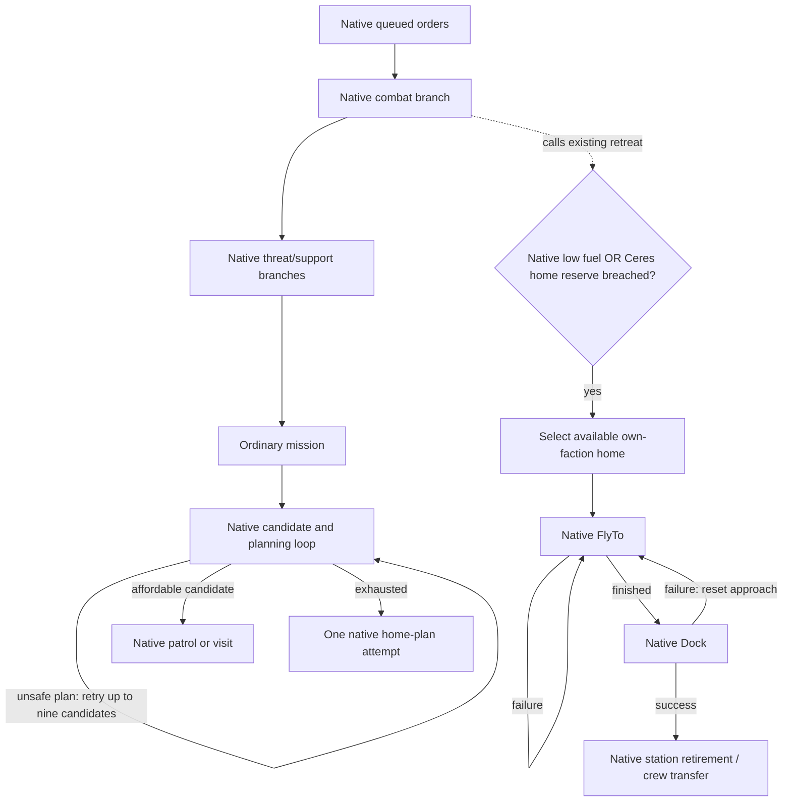

# Ceres reserve policy after the November 13 audit

The later [control handoff repair](../Navigation/FLIGHT-CONTROL-HANDOFF.md) also
releases the abandoned maneuver when this module selects/reselects a retreat
home. It changes no reserve threshold, home choice, priority or fuel-tolerant
shallow travel policy.

Implemented for game 1.0.1.10. The [reassessment](REASSESSMENT.md) retains the
pre-refactor reproductions and motivation. Boarding resolution is unchanged.

## General bug repairs

- [RCS budget](../Navigation/RCS-BUDGET.md): remaining delta-v now inverts native
  fuel consumption, including the skilled-pilot multiplier. No fuel is added or
  consumed by this getter. Invalid capability still reports zero usable delta-v.
- `NavyCandidateFuelPatch` retains native candidate generation and random/distance
  ordering, but closes native single-candidate/all-rejected affordability bypasses.
  It no longer contains a Ceres-specific round-trip prefilter.
- `LowFuelRetreatProgressPatch` repairs native retreat progression. A failed
  FlyTo does not advance to Dock. A failed Dock resets the approach stage. Obsolete
  route/propulsion commands are stopped while momentum is preserved; missing or
  destroyed goals are reselected by the existing native command. Successful
  approach, docking, fuel exhaustion and native retirement behavior remain.

These ship with the general `navigation-targets` bugfix feature. They do not
require Ceres reserve policy. Native AI trees, trigger/pledge evaluation and world
assets retain authority; the relevant asset review is in the reassessment.

## Ceres simulation policy

The extra policy still covers CCRE, GalileanConfederacy and BeltPirates vessels
with Navy, Pirate or Police pilots. Ownership alone does not pull freighters or
civilians into patrol policy. Player helm and connected groups are excluded.
Old Ceres migration flags on unsupported roles are removed without imposing a
patrol return; unrelated shared StationReturn intents are not canceled.

Native locked-goal planning decides the actual outbound cost before the 20%
homeward reserve is applied. An unsafe candidate leaves the native bounded retry
loop free to try alternatives. After all nine attempts fail, the existing result
object gets at most one native home plan; an unreachable home is not fabricated
into a successful route. The obsolete first-rejection Blackboard latch is ignored
and removed during eligible AI updates. Unlocked/manual goals retain their native
heuristic path, with the scoped round-trip reserve applied at GetNeededFuel.

The native maximum-speed heuristic can still be conservative; this refactor
removes our additional pre-plan veto rather than pretending to replace the game's
planner with an exact two-leg solution. Return cost remains a native heuristic.
No second return planner, distance leash or new population policy is introduced.

`CheckReturn` samples remaining plan cost/home reserve at most once per 30 game
seconds per pilot. The weakly keyed sample contains only timestamps, a home ID
and a boolean, not a ship/controller reference or growing history. Valid usable
torch journeys retain native planning authority. Ordinary return still uses
StationReturn at native mission priority after queue/combat/threat/support.

Combat additionally feeds that same sampled decision into native
`LowFuelRetreat`. The command retains its own retreat/approach/docking states.
For these scoped actors, it chooses an available own-faction home, rather than
the native nearest-station fallback that can pick an enemy. When another action
changes the goal or the home hull is replaced/removed, it reselects on resumption.
With no available own-faction home, it stops the abandoned maneuver and retries
selection at native cadence; it does not teleport, invent a station, or prune.

There is no new combat controller or higher-priority forced return. Native
weapons, surrender, threat/support decisions and retreat execution are retained.
An entered retreat retains the native decision to complete the retreat; it is
not canceled simply because a later reserve sample becomes favorable.

The solid root arrows show evaluation priority, not unconditional fall-through:
an executing earlier native branch can retain control. The diagram is a review
reference, not an executable extension of the traffic graph. Numeric trajectories
and physical outcomes remain outside that graph's existing slices.

## Packaging, performance and persistence

The `ceres-navigation` feature explicitly requires `ai-return`, plus its existing
navigation/refill dependencies. Recommended's existing exclusion of this policy
is unchanged. The general bug repairs remain in bugfix-only builds. The custom
composition matrix now includes isolated navigation and Ceres profiles.

No new Update callback, recurring world scan, task queue or journal is added.
Reserve evaluation remains throttled; successful native selection avoids a home
fallback calculation. Native retreat calls add bounded checks at existing command
execution points. Existing warmed idle allocation checks remain zero; actual
planning/replanning can allocate through native code and the reserve calculation.

Existing StationReturn string/boolean save fields are retained. No custom command
payload, new mod-defined save type or combat history is persisted. Native retreat
state is reconstructed normally after reload; current fuel/return intent makes
the next relevant decision. This does not repair old ships' positions or fuel.

## Offline validation

`ceres-chain` passes **174 assertions** through the shipped assembly and bundled
Mono. The suite retains native before/after reproducers for the efficiency and
retreat progression defects. It covers affordable alternative selection, bounded
exhaustion/unreachable home, manual-goal reserve, unrelated factions/roles,
player/connected exclusions, 100 combat dispatches, interrupted approach/docking,
missing/restored home, reload and ordinary return continuation. The fuel matrix
covers both efficiency values, empty/nonempty supplies, AI/player flags and
Shallow/Edit/Full modes. Full/Edit canister enumeration is a fuel-source fixture;
the getter and consumption arithmetic are native. Candidate trajectories and
physical FlyTo/Dock outcomes are fixtures; a successful assertion is not a live
Ceres flight or docking outcome.

The native recovery suite also passes 98 checks. Production Debug builds cleanly.
The native planner host retains its existing unassigned settings-field warning.
All 239 patch classes bind with zero failures/warnings. The custom builder passes
489 catalog/composition assertions and 30 compiled, verified and native-bound
profiles, including isolated Ceres and general navigation selections. Five graph
slices pass 776 model checks after source review and baseline refresh; their
opaque affordability inputs and Ceres coverage limits remain explicit.
No live Ceres intervention was requested or performed for this refactor.

The separately diagnosed [PASS completion double-integration](../Orbital/PASS-TIME-SKIPS.md)
remains a pending shared repair. This refactor does not claim to make shuttle
time skips safe or explain the original historical cluster conclusively.
