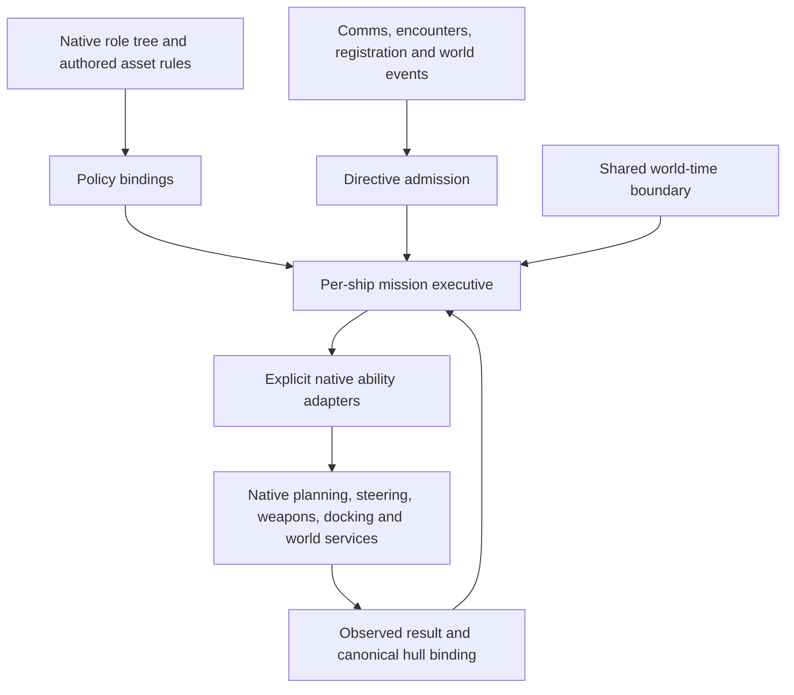

# Decision: replace the command runtime behind native role behavior

Status: **abandoned on 2026-11-19**. See the [postmortem](POSTMORTEM.md).
The decision and implementation plan below are historical. The
[offline prototype](PROTOTYPE.md) was never installed.
The current [normative replacement model](Replacement/README.md) is separate
from the descriptive game/patch behavior graph. Its first explicit ability
profile replaces the nested return lifecycle; full Navy adoption remains gated.
This is an intentional architectural replacement; it must not be presented as
another small bugfix or quietly introduced as a competing controller.

## Decision and alternatives

Proceed with a bounded mission executive for autonomous ships. Retain the native
role definitions and authored interactions as the source of choices, and retain
the repaired native world/flight services. Replace admission, execution ownership,
interruption, phase state, persistence and time-advance coordination as one design.

| Approach | Assessment |
| --- | --- |
| Continue isolated handoff fixes | Lowest immediate deployment risk, but leaves ownership and persistence contracts distributed across entrypoints. Appropriate for primitive bugs; inadequate as the only long-term strategy. |
| Replace AIShip.RunAI only | Rejected. Native nested command controllers, external command producers and world movement before AI catch-up bypass that boundary. |
| Replace ship AI, physics, economy and people together | Rejected for this project phase. It discards too much established behavior and multiplies unvalidated obligations. |
| Bounded executive with native policy/ability adapters | Selected. Centralizes the recurring contracts while preserving the reasons actors patrol, fight, surrender, assist, dock and return. Requires real adapters rather than treating every native command as an atomic function. |

The objective is fewer independent places that must uphold each rule. A lower
total hook count is a later measurable result, not a promised property of v1.

## Ownership boundary

Exactly one system drives an adopted actor. Native AIShip, pilot, crew, home,
faction, comms and registry identities remain in place. Existing status/save and
SFF consumers receive a compatible projection of the active native ability.
The old root dispatcher and role FFWD must not execute concurrently for that actor.

The executive owns engine commands and route authority. It does not own all
velocity changes: gravity, collisions, docking-group constraints, weapon impacts
and legitimate external impulses remain world simulation. Blanket filtering of
every ShipSitu field write would be incorrect.

## Preserve policy without copying a new Navy personality

Read the actual native Navy constructor tree and bind its ordered branches:
combat, threats, support and ordinary behavior. The current queue remains an
input protocol, with explicit directive categories instead of universal mission
priority. Native predicate and action implementations stay available through
adapters; their conditions, faction logic, sensor limits, random choices,
surrender negotiations and station preferences retain authority.

A reactive Sequence must re-evaluate its preceding children; a sticky phase has
durable progress. CanExecute=false keeps its authored skip semantics. Failures
require explicit continuation/retry/abort edges rather than blanket advancement
to the next operation. Known repairs can annotate a specific sequence/phase;
do not globally reinterpret every authored Failure as a fatal abort.

Predicates are not assumed pure. AreThreatsNearby and IsTargetNeutralized update
Blackboard state; target-selection commands also replace goals/routes. Execute
those operations in a controlled decision/intent-change phase. Do not evaluate
an entire native tree as a supposedly read-only shadow: it can actuate, send
messages, dock or retire ships.

Policy changes such as reserve margins, waiting behavior and local encounter
eligibility remain separately identified inputs/modules. Building an executive
does not authorize universal fuel realism, guaranteed safe returns, less combat
or different faction motives.

## Runtime contracts

1. **One controller and movement authority.** Bind a logical actor to the current
   canonical hull/controller. Each active ability receives a mission/generation
   token; stale completions cannot steer or advance a replacement mission.
2. **Explicit interruption.** Stop the previous owned route, torch/RCS inputs and
   relevant steering state before granting the next ability control. Preserve
   momentum and legitimate world forces. Calling native OnExit is insufficient.
3. **Goals belong to missions.** Preserve an interrupted mission's target ID/body
   frame/waypoint and progress separately from ship-global fields. Revalidate
   target lifetime, accessibility and native policy before resuming; combat's
   global target overwrite must not silently turn into a new patrol destination.
4. **Typed phases and results.** Distinguish Running, Completed, Failed,
   Interrupted and AwaitingWorldEffect. A failure cannot imply successful docking
   or cargo delivery. Preserve native reasons for waiting and requesting help.
5. **Events are admitted deliberately.** Keep FIFO within the relevant directive
   class, genuine urgent dodges, surrender/clearance replies and authored scripts.
   Ordinary patrols are interruptible; assigning a mission is not a license to
   bypass every emergency evaluator.
6. **Effects have acknowledgements.** Docking can transfer people and retire the
   hull. Confirm the native world result instead of continuing on a cached Ship
   reference. One bounded pending-effect slot can track submission/acknowledgement;
   no append-only flight journal or historical actor collection is required.
7. **Identity survives representation changes.** Ship replacement with the same
   logical ID rebinds a continuing actor; reserve reuse/new controller activation
   starts a new mission generation. Call sign equality alone cannot distinguish
   those cases. Never persist Unity instance IDs as durable identity.

Native actions without transactional/idempotent behavior need specific readback
and recovery rules. A local token alone cannot promise exactly-once crew/cargo
transfers across every failure or reload. The first prototype must expose those
uncertain effects, not blindly replay them.

## Native ability adapters

| Group | Initial treatment |
| --- | --- |
| Native conditions, perception and faction choices | Reuse with their real Blackboard effects and native caching. |
| FlyTo / FlyToPatrol | Retain native planner/manual steering initially. Explicitly bind mission goal, route, mode and the existing fuel watermark. |
| KeepWithinFiringDistance / KeepAtDistance | Preserve native engagement logic and weapons. Account for embedded LowFuelRetreat and subordinate command state. |
| LowFuelRetreat | Explicit state adapter or phase decomposition using existing native selection/flight/dock mechanisms and current reserve policy. Saving the outer command alone is insufficient. |
| Undock / Dock | Preserve clearance, loaded/shallow differences, tow behavior, native crew transfer and parking/retirement. Confirm the resulting binding/attachment state. |
| ComeHere / surrender / scuttle / assistance directives | Preserve command loot arguments and native authored protocols. Preflight support and safe native handback; never silently drop an unknown directive. |
| DockCargoAndDespawn, ShipboardAction, hauler pickup/dropoff | Outside the first adoption. Their role-specific world effects need their own adapters before expansion. |

Keeping native action code initially means several primitive fixes remain useful.
The executive is not evidence that native navigation, fuel, physics or docking
geometry has suddenly become correct.

## One time-advance contract

The common boundary is world time, including GUI SFF and PASS teleport travel.
Do not manufacture GUIFFWD.Active to get existing code to run.

For each supported interval: identify ownership and due decisions, advance the
active trajectory through its actual completion time, hand off once, and consume
only the residual interval in the next phase. Retain a trajectory's absolute fuel
clock/watermark. Existing motion/economy contexts must agree which component owns
that interval. Native post-jump callbacks must not repeat completed work.

Native rules that deliberately abstract shallow travel remain intact, including
the accepted fuel-tolerant travel behavior. Preserve current combat exclusions
from replacement bulk travel; do not invent fight outcomes during a skip.
Equivalent interval partitioning is required for deterministic travel/state
accounting, not asserted for stochastic combat, perception and every NPC event.

Retain the native AI scheduling budget initially. No new per-frame whole-system
scan, background Unity access or polling API is needed. Use per-actor state,
bounded queues, reusable compiled plans and native perception caches. Event wakeup
and priority-budget changes are separate measured decisions.

## Durable state and compatibility

Keep durable intent/phase, target identity/frame, mission generation, outstanding
directive, fuel settlement and pending-effect acknowledgement separate from
ephemeral perception caches, raw Unity objects and cached signatures.

The exact save format remains a prototype gate. An existing primitive Blackboard
string can transport a versioned encoded record, but native Blackboard's delimiter
format means arbitrary unescaped JSON is not automatically safe. A versioned
base64 payload is one candidate; no format or new save key is installed here.

Maintain a native fallback projection: current target, relevant native command
state and ordinary mission progress must be representable when handing back or
loading without the feature. Unexportable nested effects are a blocker, not a
reason to declare compatibility. Test upgrade, disable, removal and downgrade.

The experimental feature should start disabled. Activate only at a recognized
ownership boundary after preflight. A/B disable must perform a verified native
handoff at a safe point; do not advertise an instantaneous toggle across an
unresolved docking/boarding effect. Never run both controllers and choose the
result that looks better afterward.

## First adoption and acceptance gates

The first full lifecycle is Navy patrol -> legitimate encounter -> native combat,
surrender or retreat -> home approach -> native docking/parking and retirement.
Include incoming comms and urgent dodge. Preserve legitimate damage, defeat,
capture, unsafe decisions permitted by policy, and failure to obtain help.

Before production integration:

- Compile/bind the native Navy policy tree without copying a simplified role.
  Validate branch order, reactive/sticky semantics and the complete native-command
  closure, including subordinate controllers and reachable comms directives.
- Run the full lifecycle through native ability adapters under the bundled Mono
  runtime. Use controlled world outcomes where Unity is unavailable and label them.
- Exercise interruption/resume and stale events at every phase; target removal
  and same-ID replacement; lost navigation/crew/capability; docked/towed groups;
  hull reuse; interrupted or failed arrival; and cleanup/re-registration.
- Insert save/load before and after every transition. Verify command identity,
  fuel and one-shot/effect ownership, then native export and mod removal.
- Compare supported travel across ordinary ticks, 8x/16x deltas, short/long SFF
  and PASS. Reject double integration, skipped residual time and duplicate fuel
  or arrival effects. Retain explicit limits around combat and world events.
- Measure warmed scheduling allocations and work per decision/advance. Keep
  cached policies/abilities; measure actual planner cost separately.
- Produce a patch disposition manifest for adopted actors and prove that every
  bypassed patch's contract is covered by the new layer or retained below it.

Only then add gated runtime integration for the supported profile. First preserve
ordinary native dispatch for every other actor. Full materialized/boarding/crew
transfer validation still needs live Unity; offline fixture success cannot remove
that obligation. Unsupported actors/directives require explicit native fallback.

## Patch consolidation: realistic expectations

| Existing group | Intended disposition |
| --- | --- |
| Patrol admission and isolated restoration | Subsumed by executive admission/import for adopted Navy actors. Native fallback still needs its correction. |
| One-shot/context/FIFO queue persistence | Subsumed by executive continuation/state representation for adopted actors. Retain globally for other roles and native fallback. |
| StationReturn scheduling and FFWD ownership | Merge return intent into executive mission phases for adopted actors; retain native handback/migration and other-role support until equivalent. |
| LowFuelRetreat progression | Subsumed only after the explicit retreat adapter passes native failure/interruption cases. Reusing the unchanged native retreat still needs the repair. |
| Abandoned control/route handoff | Centralized at ownership transitions, but direct native RCS paths, fallback actors and lower-level playback may still require existing repairs. |
| Fuel arithmetic/refill, target rebinding, local reference geometry, departure waypoints, collision avoidance | Retain as native service repairs unless independently replaced and validated. |
| Orbital gravity, partial travel and freight/economy time ordering | Retain and integrate at the shared world-time boundary. An executive does not replace physical/economic simulation. |
| Native crew lifecycle, station population, factions, bounty scheduling, asset-authored interactions | Retain. Changes need independent evidence or separately approved simulation policy. |

A Navy-first prototype will not remove all shared hooks. It may temporarily add
integration points. The measurable win must be a single tested lifecycle contract
and fewer independent ownership decisions, followed by demonstrated consolidation
as adoption expands. No hook-removal number is justified yet.

## Deliverables and next concrete step

This study supplies a selected architecture, a machine-readable seam/disposition
map, a native constructor snapshot, a direct assembly inventory and 16 fresh
characterization assertions. Source references and limitations are in EVIDENCE.md.

The [offline executive/native-adapter prototype](PROTOTYPE.md) now runs selected
Navy lifecycle paths through actual native commands. It identifies remaining
acceptance blockers, including native handback during retreat, complete incoming
directive coverage and live world-time/scene integration. Those gates remain
required before any production dispatcher, patch or asset is changed.

The subsequent [replacement-model pass](Replacement/README.md) makes return
phases explicit, adds a pre-invocation effect barrier, validates a native handback
subset and revokes executive authority after release. The subsequent
[Navy lifecycle pass](Replacement/NAVY-LIFECYCLE.md) runs native combat/reaction
abilities, selected authored commands and actual world entrypoints offline.
The [retained world-service pass](Replacement/WORLD-SERVICES.md) integrates
existing Orbital/SFF/Economy scopes offline and separates physical propagation
from executive navigation ownership. It also reproduces non-GUI playback
completion fallthrough, which remains a blocker alongside complete directive
effects and production save/arrival integration. This progress does not certify
all-state removal.
