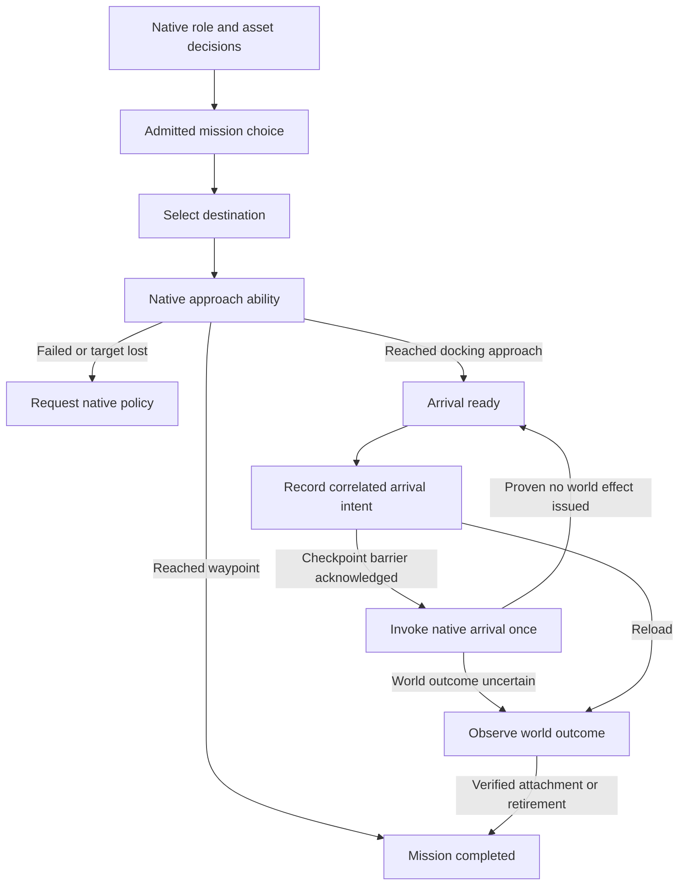

# Replacement mission execution model

Status: **offline architecture and executable contracts; not an installed feature**.
This directory is normative: it defines how the proposed replacement executes
missions. `Navigation/BehaviorGraph/` remains the separate description of native
behavior and deployed patches. No experimental overlay was added to that graph.

The current receipts bind **1.1.0.0**. See the
[1.1 rework and qualification](UPGRADE-1.1.0.0.md) for native changes, the shared
time coordinator and remaining engine boundaries. The earlier 1.0.1.10 receipts
are preserved under [Baselines/1.0.1.10](Baselines/1.0.1.10/test-results.json).

The first prototype showed that ownership and persistence could be centralized,
but still scheduled native command trees and reflected opaque nested controllers.
The current pass adds native Navy policy/ability fixtures around the explicit
return lifecycle: combat, timed reactions and authored command handling. It does
not claim complete replacement of Navy decisions or every ship role.

## Source of truth and executable implementation

- [mission-model.json](mission-model.json): mission entry profiles, phase/event
  transitions, guards, state operations, effects, bounds and invariants.
- [ability-contracts.json](ability-contracts.json): native ability boundaries,
  authored asset examples, state responsibilities and qualification status.
- [Contracts reducer](../../../Tools/ShipExecutiveStudy/Contracts/Machine.cs):
  interprets those phase transitions and implements the explicit lifecycle APIs.
  It references no game assembly, Unity or Harmony.
- [Native return adapter](../../../Tools/ShipExecutiveStudy/Prototype/NativeReturnActor.cs):
  executes selection, approach and arrival primitives as separate abilities.
- [Conformance results](conformance-results.json) and [combined test results](test-results.json).
- [Generated phase diagram](mission-model.mmd), rendered from the executable JSON.
- [Navy lifecycle qualification and remaining runtime gates](NAVY-LIFECYCLE.md).
- [Retained Orbital/SFF/Economy integration](WORLD-SERVICES.md).
- [Command receipt, transfer and dialogue/reload qualification](COMMAND-EFFECTS.md).
- [Native save pipeline, participant arrival readback and patrol handback](SAVE-ARRIVAL.md).

The combined suite passes **529 assertions across 101 scenarios**, including the
original reference prototype and subsequent contract/native ability cases. It
exercises all 27 declared phase transitions. That is coverage of this bounded model, not proof
of every native behavior or every interleaving. The 64 deterministic adversarial
walks contain 24 operations each and are explicitly not exhaustive model checking.



## Decisions versus execution

The replacement does not decide that a ship must survive, return home, have
enough fuel or avoid combat. Native/authored policy supplies those choices and
their source context. The executive makes their execution well-defined.

For example, the qualified return fixture uses the native low-fuel condition
and native nearest-station selector. The executive owns selection, approach,
arrival and confirmation as explicit phases. It never runs `LowFuelRetreat` as
a hidden nested controller or saves its `_retreating`/`_docking` flags.

The native `FlyTo` primitive and its own SaveData payload remain in use. Its
subordinate path/manual steering is a retained flight service, not a second
return mission. Existing fuel, target geometry, orbital and collision repairs
remain useful. Their elimination is not implied by these results.

Policy provenance in a `PolicyChoice` is an adapter contract and diagnostic
reference, not a security proof. A future runtime must accept choices only from
validated native/asset bindings. The Navy fixture now visits the actual native
policy tree and uses explicit combat/reaction adapters. Selected authored reply
rules now execute natively. Equipment selection, personality scoring, crew effects
and several world interfaces remain fixture boundaries; this
is not complete Navy policy equivalence or arbitrary directive support.

## Mission and actor state

| State | Responsibility |
| --- | --- |
| Actor ID and activation | Distinguish a continuing person/ship agent from a new use of the same hull or call sign. |
| Binding revision | Reject callbacks from old native object representations. Reconstruction increments it. |
| Mission ID and ability attempt | Reject completions from interrupted missions and prior phases. |
| Mission kind, source and logical goal | Retain intent independently of ship-global target fields. Coordinates use native AU and identify their reference frame. |
| Explicit phase and flight payload | Save durable progress without recursively snapshotting arbitrary command/private-field graphs. |
| Bounded suspended missions | Preserve interrupted work; four is the prototype bound, not a gameplay personality rule. Full capacity refuses admission explicitly. |
| One pending arrival intent | Track effect identity and destination; no append-only actor or flight journal. |
| Authority and disposition | Separate executive/native ownership from active/retired actor lifetime. Retirement cannot resurrect suspended missions. |

`Begin`, `Preempt`, `Replace`, `Resume`, `Rebind`, `RequestDisable`,
`ReleaseToNative` and `Restore` are lifecycle operations implemented by the reducer.
They are separate from the JSON phase transitions. Profile entry phases and
within-mission phase transitions are loaded from JSON; target-selection policy
is not encoded in this model.

Preemption requires authorization from policy and releases old movement inputs
before the new ability runs. Travel resumes through canonical revalidation.
A suspended failed approach remains `AwaitingPolicy`; interruption does not
authorize retry. Interrupted combat/reaction returns to native policy evaluation,
preserving its mission kind instead of being transformed into ordinary travel.

Observed retirement clears suspended work and prevents new missions, resume or
representation rebinding for that actor activation. A later genuine launch is a
new adoption/activation; it cannot inherit the retired actor's old authority.
Observed attachment is a different outcome and does not retire the actor.

## Typed ability outcomes

| Outcome | Meaning |
| --- | --- |
| Progress | The current ability still owns execution. No implicit phase advancement. |
| Blocked | Temporary inability, including missing pilot. An existing authorized route may continue. |
| ApproachFailed / GoalUnavailable | Release movement and ask native policy to reconsider. No automatic docking or endless retry loop. |
| ApproachComplete | A prerequisite was actually met. Waypoint completion and docking approach have different transitions. |
| NoWorldEffectIssued | The adapter proved that this invocation did not enter the native world-effect seam. A new attempt is permitted. |
| WorldOutcomeUnknown | Submission may have happened. Observe without replaying it. |
| WorldEffectObserved | Correlated world readback confirms attachment or retirement; a command success code is insufficient. |

All observations carry actor, activation, binding, mission and attempt identity.
Arrival observations additionally carry the pending effect ID and destination.
Rejected inputs do not mutate state. Epochs must be finite and monotonic.

## Save boundaries and effect uncertainty

The reducer serializes only an explicit versioned DTO, logical references,
primitive state and the named flight adapter payload. CLR type-name loading is
disabled. Model hash, native binding, actor activation, phase and bounds are
validated before reconstruction.

An arrival record is prepared before native invocation. Loading either a saved
prepared record or an unconfirmed submission enters `ArrivalUncertain`. A saved
label alone cannot prove whether an intervening native invocation occurred.

Tests cover both sides of the gap: an old executive record with a committed
native world, and a prepared record whose invocation never occurred. The former
finishes from world readback; the standalone latter stays uncertain. It does not guess and
repeat a possible crew transfer. A production reconciliation adapter still needs
complete crew/scene outcome evidence; unresolved uncertainty is a real blocker,
not a license for forced cleanup or teleportation.
The coherent native port separately validates a pre-invocation marker against
the saved original phase and matching native wire snapshot; that stronger proof
can return a prepared arrival to `ArrivalReady` without weakening standalone reload.

The original standalone fixture flushes one checkpoint file to test ordering.
The [integrated native save port](SAVE-ARRIVAL.md) instead captures executive state
with the native DTO under an operation fence, then runs the real save worker.
It performs no per-arrival disk write. Ship/crew scene providers and a single
actor limit this qualification; it is not a complete production save/load.

Native `CrewSim.DockAndDespawn` can transfer or destroy people according to its
drop-off trigger and reputation logic. The native-arrival provider now exercises
mixed outcomes across group crew, including a destroyed captain and partial
transfer. It requires participant readback or witnessed destruction; it cannot
grant NPC immortality or treat absence as transfer. Physical scene effects and
company/roster policy remain outside this qualification.

## Handback and one writer

The return adapter can export an ordinary funded Navy return at approach/arrival:
canonical target, native flight payload and native main cursor 2 or 3. It first
checks native serialization and conflicting combat/queue state. Ordinary native
main-patrol approaches to non-docking waypoints also qualify. Tests run the real
dispatcher and a native archive round trip. Executive inbox/reaction state must
be checked too; the native queue alone is insufficient.

Only after certification does authority become `Native`. The executive refuses
new events, mission admission, ticking and time advance afterward, including
after reload. An eligibility flag alone is not a certified projection.

An unrepresentable combat retreat, suspended continuation or pending world effect
defers disable. It does not clear combat state to make export convenient. A
verified retired actor is another safe release boundary. This is not a general
save-removal or downgrade guarantee.

## Boundaries still open

| Area | Current status |
| --- | --- |
| Explicit return lifecycle | Native-fixture qualified; opaque native retreat is forbidden by a test hook. |
| Interruption, identity, failure, retirement and pending effects | Executable model tests and adversarial walks. |
| Return and ordinary main-patrol handback | Qualified subsets; native dispatcher and patrol archive continuation tested. |
| Native save/arrival boundary | Native collector/writer/parser and authored crew disposition branches run under providers; scene reconstruction remains. |
| Combat and urgent reactions | Native short/long steering, policy and timed dodge fixtures; actual weapon/decoy outcomes and active Ceres case remain. |
| Authored comms | 13 aliases inventoried; native receipt, transfer, selected reply/role/condition rules and message reload qualified under providers. Full crew/equipment effects remain. |
| Already-stranded ships and native cleanup decisions | Not qualified by the funded-return fixture. Preserve native lifecycle policy until an explicit adapter exists. |
| Physics, materialized groups, crew transfer and actual scene loading | Fixture boundaries; not a live Unity validation. |
| Normal/SFF/PASS world entrypoints | Native world calls/iterators, queue and real Orbital/Economy scopes run offline; shared playback completion remains a reproduced blocker. |
| Performance | No FPS, hook-count or allocation win claimed. Current code is a research implementation. |

The next integration work is the separate playback repair and real equipment/
materialized ability qualification. Actual Unity scene/load lifetimes, active
Ceres policy and broader handback remain gates before runtime adoption. See
[NAVY-LIFECYCLE.md](NAVY-LIFECYCLE.md). Current production repairs stay in place
for all actors.

## Reproduction

From the repository root, with the current full Debug plugin already built:

```powershell
powershell -NoProfile -ExecutionPolicy Bypass -File Tools/ShipExecutiveStudy/Prototype/Run.ps1
```

The runner builds only offline projects. Detailed output goes to ignored
`obj/ShipExecutivePrototype` and `obj/ShipExecutiveModel`; the published result
files here are reviewed snapshots. The native assembly baseline is checked before
execution. No running-game inspection, intervention, deployment or production
patch/asset modification is performed.
