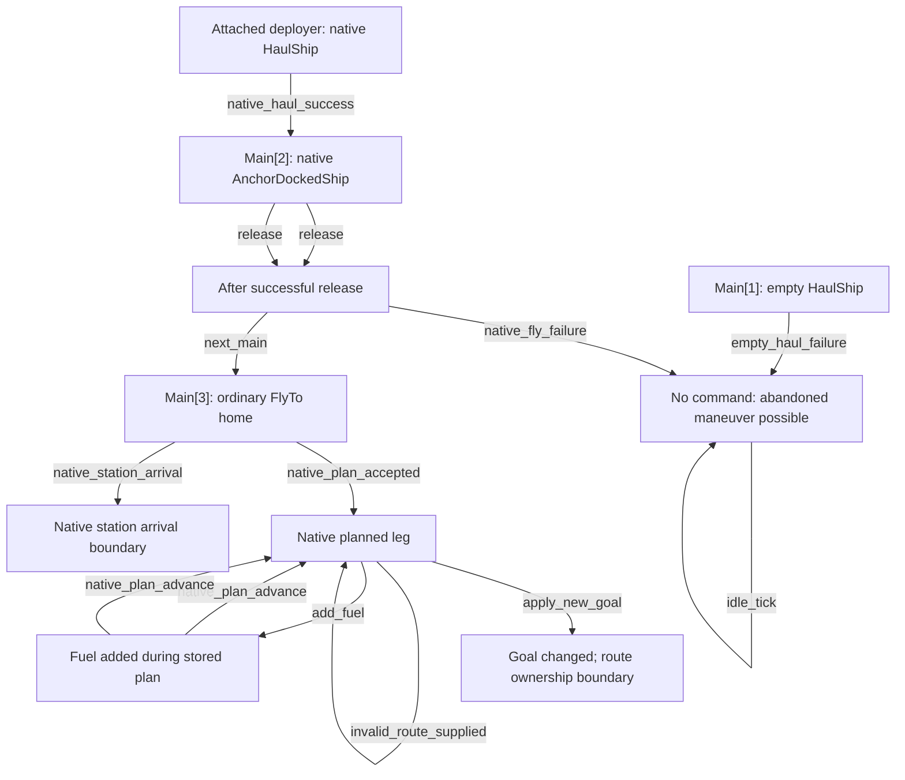

<!-- Generated by Tools/AIBehaviorGraph. Edit JSON sources, not this file. -->

# deployer-1.0.1.10

Partial control-point graph, not a full state machine. Edge guards and effects are in JSON. Operator events are explicit, never autonomous defaults.

## flow



## motion

```mermaid
flowchart TD
```

## lifecycle

```mermaid
flowchart TD
```
