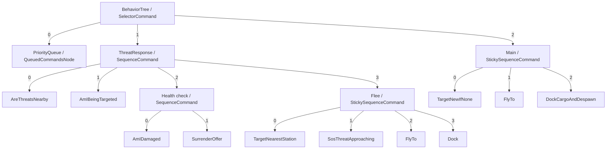

<!-- Generated from native constructor snapshot. -->

# Native cargo and civilian control trees

Children are ordered as in the shipped constructors. Priority queues contain dynamic commands. Physical leaf results are not inferred from this diagram.

## cargo

## civilian

```mermaid
flowchart TD
  civilian["BehaviorTree / SelectorCommand"]
  civilian_0["PriorityQueue / QueuedCommandsNode"]
  civilian -->|"0"| civilian_0
  civilian_1["CombatResponse / SequenceCommand"]
  civilian_1_0["AmIInCombat"]
  civilian_1 -->|"0"| civilian_1_0
  civilian_1_1["InCombat / SelectorCommand"]
  civilian_1_1_0["Health check / SequenceCommand"]
  civilian_1_1_0_0["AmIDamaged"]
  civilian_1_1_0 -->|"0"| civilian_1_1_0_0
  civilian_1_1_0_1["SurrenderOffer"]
  civilian_1_1_0 -->|"1"| civilian_1_1_0_1
  civilian_1_1 -->|"0"| civilian_1_1_0
  civilian_1_1_1["Defensive Action / SequenceCommand"]
  civilian_1_1_1_0["DoIHaveDecoys"]
  civilian_1_1_1 -->|"0"| civilian_1_1_1_0
  civilian_1_1_1_1["AreMissilesComingMyWay"]
  civilian_1_1_1 -->|"1"| civilian_1_1_1_1
  civilian_1_1_1_2["DeployDecoys"]
  civilian_1_1_1 -->|"2"| civilian_1_1_1_2
  civilian_1_1 -->|"1"| civilian_1_1_1
  civilian_1_1_2["Fight / SequenceCommand"]
  civilian_1_1_2_0["AmIArmed"]
  civilian_1_1_2 -->|"0"| civilian_1_1_2_0
  civilian_1_1_2_1["SetEngagementProfile"]
  civilian_1_1_2 -->|"1"| civilian_1_1_2_1
  civilian_1_1_2_2["Undock"]
  civilian_1_1_2 -->|"2"| civilian_1_1_2_2
  civilian_1_1_2_3["InCombat / SelectorCommand"]
  civilian_1_1_2_3_0["Short range attack / SequenceCommand"]
  civilian_1_1_2_3_0_0["DoIPreferShortRange"]
  civilian_1_1_2_3_0 -->|"0"| civilian_1_1_2_3_0_0
  civilian_1_1_2_3_0_1["KeepWithinFiringDistance"]
  civilian_1_1_2_3_0 -->|"1"| civilian_1_1_2_3_0_1
  civilian_1_1_2_3 -->|"0"| civilian_1_1_2_3_0
  civilian_1_1_2_3_1["Long range attack / SequenceCommand"]
  civilian_1_1_2_3_1_0["KeepAtDistance"]
  civilian_1_1_2_3_1 -->|"0"| civilian_1_1_2_3_1_0
  civilian_1_1_2_3 -->|"1"| civilian_1_1_2_3_1
  civilian_1_1_2 -->|"3"| civilian_1_1_2_3
  civilian_1_1 -->|"2"| civilian_1_1_2
  civilian_1_1_3["Flee / StickySequenceCommand"]
  civilian_1_1_3_0["TargetEscapeStation"]
  civilian_1_1_3 -->|"0"| civilian_1_1_3_0
  civilian_1_1_3_1["Undock"]
  civilian_1_1_3 -->|"1"| civilian_1_1_3_1
  civilian_1_1_3_2["FlyTo"]
  civilian_1_1_3 -->|"2"| civilian_1_1_3_2
  civilian_1_1_3_3["Dock"]
  civilian_1_1_3 -->|"3"| civilian_1_1_3_3
  civilian_1_1 -->|"3"| civilian_1_1_3
  civilian_1 -->|"1"| civilian_1_1
  civilian -->|"1"| civilian_1
  civilian_2["ThreatResponse / SequenceCommand"]
  civilian_2_0["AreThreatsNearby"]
  civilian_2 -->|"0"| civilian_2_0
  civilian_2_1["AmIBeingTargeted"]
  civilian_2 -->|"1"| civilian_2_1
  civilian_2_2["Flee / StickySequenceCommand"]
  civilian_2_2_0["TargetNearestStation"]
  civilian_2_2 -->|"0"| civilian_2_2_0
  civilian_2_2_1["SosThreatApproaching"]
  civilian_2_2 -->|"1"| civilian_2_2_1
  civilian_2_2_2["Undock"]
  civilian_2_2 -->|"2"| civilian_2_2_2
  civilian_2_2_3["FlyTo"]
  civilian_2_2 -->|"3"| civilian_2_2_3
  civilian_2_2_4["Dock"]
  civilian_2_2 -->|"4"| civilian_2_2_4
  civilian_2 -->|"2"| civilian_2_2
  civilian -->|"2"| civilian_2
  civilian_3["Main / StickySequenceCommand"]
  civilian_3_0["Undock"]
  civilian_3 -->|"0"| civilian_3_0
  civilian_3_1["TargetNewIfNone"]
  civilian_3 -->|"1"| civilian_3_1
  civilian_3_2["FlyTo"]
  civilian_3 -->|"2"| civilian_3_2
  civilian_3_3["Dock"]
  civilian_3 -->|"3"| civilian_3_3
  civilian_3_4["Hold"]
  civilian_3 -->|"4"| civilian_3_4
  civilian -->|"3"| civilian_3
```

