<!-- Generated by Tools/AIBehaviorGraph. Edit JSON sources, not this file. -->

# ostrabus-traffic-current

Partial control-point graph, not a full state machine. Edge guards and effects are in JSON. Operator events are explicit, never autonomous defaults.

## flow

```mermaid
flowchart TD
  n_t_dispatch["Native dispatch / spawn clock"]
  n_t_spawn["Reserve selection or new hull"]
  n_t_pick["Target selection"]
  n_t_removed["Destroyed hull / unresolved voyage"]
  n_t_root["AI reaction / queue / behavior root"]
  n_t_reaction["Active reaction"]
  n_t_queue["Queued one-shot"]
  n_t_combat["Civilian combat selector"]
  n_t_threat["Threat sequence"]
  n_t_undock["Undock / unmoor"]
  n_t_flee["Native escape / station-return flight"]
  n_t_fly["Native planned or manual flight"]
  n_t_conversion["Asteroid representation conversion"]
  n_t_asteroid["Civilian sampled asteroid"]
  n_t_ship["Civilian nonstation hull candidates"]
  n_t_station["Civilian public station candidates"]
  n_t_fallback["Owner-filtered fallback / interface home"]
  n_t_unresolved["Needs further native outcome"]
  n_t_transfer["Cargo-specific station handoff"]
  n_t_dock["Ordinary Dock handoff"]
  n_t_hold["Nonstation visit / Hold"]
  n_t_retire["Transfer crew / hide / unregister"]
  n_t_reserve["Hidden hull reserve"]
  n_t_atc["Region cleanup"]
  n_t_sff["World SFF AI catch-up"]
  n_t_sff_role["Role-specific FFWD"]
  n_t_sff_queue["FFWD result / queued continuation"]
  n_t_economy["Chronological freight timeline"]
  n_t_uncrewed["Uncrewed controller boundary"]
  n_t_dispatch -->|"dispatch"| n_t_spawn
  n_t_dispatch -->|"dispatch"| n_t_dispatch
  n_t_dispatch -->|"dispatch"| n_t_spawn
  n_t_dispatch -->|"dispatch"| n_t_dispatch
  n_t_dispatch -->|"dispatch"| n_t_spawn
  n_t_spawn -->|"spawn"| n_t_dispatch
  n_t_spawn -->|"spawn"| n_t_pick
  n_t_spawn -->|"spawn"| n_t_removed
  n_t_pick -->|"register_freight"| n_t_pick
  n_t_pick -->|"register_pass"| n_t_pick
  n_t_pick -->|"register_civilian"| n_t_pick
  n_t_pick -->|"load_goods"| n_t_pick
  n_t_root -->|"tick"| n_t_reaction
  n_t_root -->|"tick"| n_t_queue
  n_t_root -->|"tick"| n_t_combat
  n_t_root -->|"tick"| n_t_threat
  n_t_root -->|"tick"| n_t_undock
  n_t_root -->|"tick"| n_t_pick
  n_t_reaction -->|"reaction_finished"| n_t_root
  n_t_queue -->|"queue_tick"| n_t_root
  n_t_combat -->|"combat_response"| n_t_root
  n_t_combat -->|"combat_response"| n_t_root
  n_t_combat -->|"combat_response"| n_t_root
  n_t_combat -->|"combat_response"| n_t_root
  n_t_combat -->|"combat_response"| n_t_flee
  n_t_threat -->|"threat_response"| n_t_flee
  n_t_threat -->|"threat_response"| n_t_flee
  n_t_threat -->|"threat_response"| n_t_pick
  n_t_root -->|"station_return"| n_t_flee
  n_t_flee -->|"escape_target"| n_t_fly
  n_t_undock -->|"undock_finished"| n_t_pick
  n_t_undock -->|"unmoor_unvisited_asteroid"| n_t_conversion
  n_t_pick -->|"choose_target"| n_t_fly
  n_t_pick -->|"choose_target"| n_t_fly
  n_t_pick -->|"choose_target"| n_t_asteroid
  n_t_pick -->|"choose_target"| n_t_ship
  n_t_pick -->|"choose_target"| n_t_station
  n_t_asteroid -->|"sample_asteroid"| n_t_fly
  n_t_asteroid -->|"sample_asteroid"| n_t_ship
  n_t_ship -->|"sample_ship"| n_t_fly
  n_t_ship -->|"sample_ship"| n_t_station
  n_t_station -->|"sample_station"| n_t_fly
  n_t_station -->|"sample_station"| n_t_fallback
  n_t_fallback -->|"fallback_exists"| n_t_fly
  n_t_fallback -->|"fallback_missing"| n_t_unresolved
  n_t_pick -->|"low_fuel_home"| n_t_fly
  n_t_fly -->|"ordinary_tick"| n_t_fly
  n_t_fly -->|"arrival"| n_t_transfer
  n_t_fly -->|"arrival"| n_t_dock
  n_t_fly -->|"arrival"| n_t_dock
  n_t_fly -->|"target_replaced"| n_t_fly
  n_t_dock -->|"dock_nonstation"| n_t_hold
  n_t_dock -->|"dock_station"| n_t_retire
  n_t_transfer -->|"unload"| n_t_retire
  n_t_transfer -->|"unload"| n_t_retire
  n_t_retire -->|"retirement [conditional]"| n_t_reserve
  n_t_retire -->|"dropoff_rejected"| n_t_reserve
  n_t_hold -->|"hold_tick"| n_t_hold
  n_t_hold -->|"hold_tick"| n_t_hold
  n_t_hold -->|"hold_tick"| n_t_hold
  n_t_hold -->|"hold_tick"| n_t_undock
  n_t_reserve -->|"pool_reuse"| n_t_spawn
  n_t_fly -->|"other_actor_reuses_goal"| n_t_fly
  n_t_fly -->|"crew_transfer"| n_t_fly
  n_t_fly -->|"leave_region"| n_t_atc
  n_t_atc -->|"region_cleanup"| n_t_fly
  n_t_atc -->|"region_cleanup"| n_t_removed
  n_t_atc -->|"station_transit"| n_t_atc
  n_t_fly -->|"stale_cleanup"| n_t_removed
  n_t_fly -->|"stale_cleanup"| n_t_fly
  n_t_fly -->|"save_reload"| n_t_fly
  n_t_fly -->|"begin_sff"| n_t_sff
  n_t_sff -->|"dispatch_opportunities [conditional]"| n_t_sff
  n_t_sff -->|"ai_ffwd [conditional]"| n_t_sff_role
  n_t_sff_role -->|"role_ffwd"| n_t_sff_queue
  n_t_sff_role -->|"role_ffwd"| n_t_sff_queue
  n_t_sff_role -->|"role_ffwd"| n_t_sff_queue
  n_t_sff_role -->|"role_ffwd"| n_t_sff_queue
  n_t_sff_role -->|"role_ffwd"| n_t_sff_queue
  n_t_sff_role -->|"role_ffwd"| n_t_sff_queue
  n_t_sff_role -->|"role_ffwd"| n_t_sff_queue
  n_t_sff_queue -->|"queue_tick"| n_t_root
  n_t_sff_queue -->|"queue_tick"| n_t_reserve
  n_t_economy -->|"timeline_partial"| n_t_fly
  n_t_economy -->|"timeline_arrival"| n_t_retire
  n_t_root -->|"tick"| n_t_threat
  n_t_transfer -->|"unload"| n_t_retire
  n_t_sff_role -->|"role_ffwd"| n_t_sff_queue
  n_t_atc -->|"region_cleanup"| n_t_removed
  n_t_sff_role -->|"role_ffwd"| n_t_sff_queue
  n_t_sff_role -->|"role_ffwd"| n_t_sff_queue
  n_t_sff_role -->|"role_ffwd"| n_t_sff_queue
  n_t_sff_role -->|"role_ffwd"| n_t_sff_queue
  n_t_sff_role -->|"role_ffwd"| n_t_sff_queue
  n_t_sff_role -->|"role_ffwd"| n_t_sff_queue
  n_t_fly -->|"queue_refill [conditional]"| n_t_fly
  n_t_fly -->|"destination_retires [conditional]"| n_t_fly
  n_t_fly -->|"visit_tick [conditional]"| n_t_fly
  n_t_sff_role -->|"validate_visit_sff [conditional]"| n_t_sff_role
  n_t_atc -->|"region_cleanup"| n_t_removed
  n_t_atc -->|"region_cleanup"| n_t_removed
  n_t_pick -->|"load_goods / cargo_loading"| n_t_pick
  n_t_sff -->|"ai_ffwd / bounded_catchup [conditional]"| n_t_fly
  n_t_sff -->|"ai_ffwd / economic_catchup [conditional]"| n_t_economy
  n_t_sff -->|"dispatch_opportunities / economic_catchup [conditional]"| n_t_sff
  n_t_fly -->|"controller_tick / crew_integrity"| n_t_uncrewed
  n_t_fly -->|"target_removed / permanent_goal_removal"| n_t_root
  n_t_conversion -->|"stellar_recreated / stellar_conversion_scope"| n_t_pick
  n_t_conversion -->|"conversion_failed / stellar_conversion_scope"| n_t_unresolved
  n_t_sff_role -->|"role_ffwd / civilian_coordinates"| n_t_sff_queue
  n_t_sff_role -->|"role_ffwd / civilian_coordinates"| n_t_sff_queue
  n_t_sff_role -->|"role_ffwd / civilian_coordinates"| n_t_sff_queue
  n_t_atc -->|"region_cleanup / player_connected_region_retention"| n_t_fly
  n_t_fly -->|"queue_refill / player_connected_region_retention [conditional]"| n_t_fly
  n_t_ship -->|"sample_ship / civilian_visit_lifetime"| n_t_station
  n_t_fly -->|"destination_retires / civilian_visit_lifetime [conditional]"| n_t_undock
  n_t_fly -->|"destination_retires / civilian_visit_lifetime [conditional]"| n_t_fly
  n_t_fly -->|"visit_tick / civilian_visit_lifetime [conditional]"| n_t_undock
  n_t_fly -->|"visit_tick / civilian_visit_lifetime [conditional]"| n_t_undock
  n_t_sff_role -->|"validate_visit_sff / civilian_visit_lifetime [conditional]"| n_t_undock
  n_t_sff_role -->|"validate_visit_sff / civilian_visit_lifetime [conditional]"| n_t_undock
  n_t_retire -->|"retirement / civilian_visit_lifetime [conditional]"| n_t_hold
  n_t_fly -->|"station_collision_other_region / controller_identity"| n_t_fly
```

