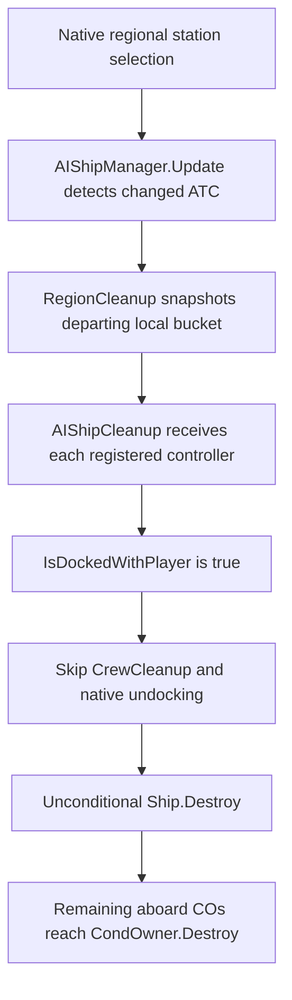

# Player-connected AI hull destruction on ATC change

Status: confirmed vanilla control-flow defect on 1.0.1.10, repaired by
`MiscBugFixes/PlayerAttachedRegionPatch.cs`. Native reproduction and production
patch regression checks pass offline.

## Normal caller path

`CollisionManager.CheckCollisions` selects the player's nearest regional station
during flight. `RefreshCurrentRegion` also performs native nearest-station
selection after transit, ferry arrival and other player movement/loading events.



There is no upstream connected-group filter in `RegionCleanup`. `AddAIToDict`
accepts a crewed local controller while its hull is attached. Registration stays
in its old region; the cleanup snapshot does not reclassify its current position
or exclude a player connection.

`Ship.IsDockedWithPlayer` traverses the whole docking chain and tests ownership
against `CrewSim.coPlayer.strID`. It protects connections to player-owned ships
even when the player character is elsewhere. In `AIShipCleanup`, that positive
test encloses only crew relocation and voluntary undocking. The following
ToggleVis/Destroy calls execute regardless. Stations represented by `bIsBO`
have an earlier return; INTERREGIONAL controllers are outside the local bucket.

## Native reproduction

Run from the repository root:

```powershell
dotnet build Tests/AiPlannerDiagnosis -c Release
dotnet run --project Tests/SaveJsonCompatibility/Host -c Release --no-build -- Tests/AiPlannerDiagnosis/bin/Release/netstandard2.1/AiPlannerDiagnosis.dll region-cleanup
```

The mode passes 1,524 assertions: 272 existing lifecycle checks plus 1,252 regional
checks across 91 cases. The first 44 cases preserve the native/current-target-hook
failure contrast. The following 47 exercise the cleanup repair, including five
with the existing crew-integrity registration/execution hooks. It executes native regional selection, ownership lookup,
recursive docking traversal, AddAIToDict, Update, RegionCleanup, AIShipCleanup,
controller unregistration, StarSystem registry removal and Ship.Destroy.
It does not directly invoke the suspect cleanup helper or prescribe its result.

| Case | Native outcome |
| --- | --- |
| Police, Navy, Scav and Civilian, full or shallow, directly connected to a player-owned hull | AI hull destroyed; crew relocation skipped; remaining NPC CO reaches destruction. |
| Same roles connected through an intermediate hull | Same outcome; the ownership test follows the chain. |
| Region unchanged | Hull and people survive. |
| INTERREGIONAL cargo controller | Hull and people survive the local-region cleanup. |
| Station-body controller | Controller unregisters; hull and people survive. |
| Player travels separately; owned tug and connected AI stay behind | AI hull/crew destruction remains reachable. The player need not tow them across the boundary. |
| Player character aboard the connected local AI hull | The controlled character also reaches CO destruction. This is a destruction-path result, not a claim about game-over UI or permanent death records. |
| Unconnected empty local AI | Native CrewCleanup is called, then the empty hull is destroyed. |

The original reproduction matrix runs both without and with the production
target-lifetime destruction hooks. Those hooks do not prevent or cause the loss.
The boarding module observes Update in a postfix, after this destruction;
crew-integrity hooks do not intercept RegionCleanup/AIShipCleanup.

The repaired matrix covers Police, Navy, Scav, Civilian, Pirate, deploying and
retrieving haulers, and freight controllers, each full/shallow and direct/chained.
It also checks repeated boundaries, the player travelling separately, the player
aboard the retained hull, ownership change, local versus remote detachment,
registered/unregistered crewless faction captures and a separately classified
derelict. Genuine INTERREGIONAL freight and native station-body handling remain
unchanged; an unconnected empty local controller still takes native cleanup.

## Fixture boundaries

World positions represent consistent before/after movement endpoints; thrust and
the intervening voyage are not simulated. Docking links and registered ownership
are fixture inputs; native traversal and classification execute. Unity object,
render and asset materialization calls are controlled boundaries. Mechanical CO
map removal and terminal CondOwner destruction are observed fixtures; the native
hull destructor decides which COs reach them. Native CrewCleanup is observed,
not replaced, and the positive cases verify it is never called.

The native IsTestCase flag prevents unrelated spawning after cleanup. Its gate
occurs after RegionCleanup, RunAIQueue and CheckTracking. The original reproduction
stubs the latter two. Repaired cases execute actual RunAIQueue/Fill/Dequeue and
observe the selected RunAI leaf instead of running navigation/physics. CheckTracking
remains a boundary. Native saved-controller construction, AddAIToShip, blackboard
serialization/loading and registration execute; role/asset construction in SetupAI
is a fixture. This is a controller save-boundary test, not a complete save-load run.

## Assets and defect ownership

`TXTOKLGRecycleStations` lists OKLG, its businesses, residences, Mescaform, FLOT
and other local facilities. `BuildRegionalStationDict` reads these authored
recycling mappings. The reproduction includes a valid destination mapping; the
failure is not an empty recycling-list artifact.

`TIsNPCPrunable` excludes player and player crew. `TIsTrafficAI` also excludes
combat/unconscious people. Neither is consulted before this hull destruction.
`TIsValidStationDropOff` applies to ordinary station retirement, not this branch.
Editing these JSON definitions cannot repair the misplaced C# destruction scope.

## Repair and scheduling lifetime

The AIShipCleanup prefix extends its existing native player-connection exemption
to the whole destructive transaction. It preserves the hull, crew, docking links,
visibility, motion, fuel, home, pilot and current command tree. Station bodies
retain their earlier native branch. No faction, capture or rescue policy is added.

Retained local controllers move to the native INTERREGIONAL bucket, so clearing
the departing regional queue does not strand them. A primitive string blackboard
key, `Ostrabus.PlayerAttachedRegion`, records their original scheduling region;
home station remains separate and unchanged. No static collection retains ships,
controllers, people or blackboards.

A guarded transpiler changes the local lookup at native queue refill. It examines
only marked global controllers. While connected to a player-owned hull they stay
global. After detachment or loss of player ownership, the native physical nearest
regional station determines their local bucket and the marker is removed. Native
queue filling still chooses priorities and executes only current-region locals
plus global traffic. A detached ship in another region returns to normal dormant
local scheduling until that region is active. Missing station/world context defers
reclassification without deleting the ship or controller.

The repair adds two patched methods, no frame callback and no world scan on every
Update. At queue refill it walks the existing global list, skips unmarked traffic,
and reuses a cleared string-ID buffer for native recursive connectivity checks.
Native registration/queue allocation costs remain native. The buffer holds no game
objects and its IDs are cleared after use.

The marker and INTERREGIONAL membership use native save formats. Loading without
Ostrabus needs no custom type: vanilla ignores the unknown primitive key and can
schedule the saved global controller. It will not perform our detach reclassification
while the mod is absent. The fix prevents future cleanup loss; it cannot recreate
an already deleted ship or crew.

## Captured faction ships are not necessarily derelicts

Native `Ship.IsDerelict()` means `DMGStatus == Damage.Derelict`. Having no crew,
being damaged, or having been captured does not establish that classification.
The AI cleanup repair applies regardless of the connected hull's faction/owner.
An unregistered crewless capture needs no invented controller: native
DerelictCleanup already excludes player-connected hulls if it considers them.

BCER is a regional ATC station; BCRS is not flagged as a separate region. A user's
historical captured Belt Pirate hull disappearing from a BCER residence is
consistent with the AI-cleanup defect only if a local controller remained
registered. Without its old state, that incident's particular cause is unproved.
