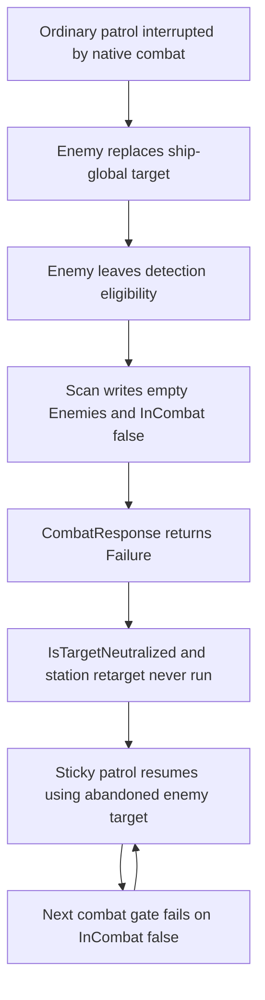

# Lost-contact combat cleanup is bypassed before patrol resumes

Status: implemented against 1.0.1.10 in
[CombatCleanupAdmissionPatch.cs](CombatCleanupAdmissionPatch.cs). The shipped
assembly tests pass 161 Navy and 360 Blockade checks, including untouched native
reproductions and the actual production constructor hooks.

## Observed case

CCRE Navy O-1WFF, Halberd, retained pirate O-60W, Deserted Leopard, as both its
scan and combat target while executing ordinary FlyToPatrol. Its Blackboard had
InCombat=false, an empty Enemies collection and Combatants containing O-60W.
The patrol's target situation was a detached older situation, rather than the
pirate's current live situation. There was no NavData. Halberd still had living,
awake crew, eight RCS thrusters and about 44% RCS fuel at the initial capture.

The real pirate was approximately 4,236 km away. Native AreThreatsNearby has a
2,500 km eligibility limit, independently of whether its input signature cache
contains a farther contact. The pirate also had no controller, and both saved
navigation consoles exceeded their damage maximum. This supports legitimate
combat disablement; the exact historical unregistration callback is not captured.

After reload with the acquisition exclusion from
[COMBAT-NEUTRALIZATION.md](COMBAT-NEUTRALIZATION.md), Halberd still had the same
contradictory patrol/combat state. Terror's repeated acquisition of the disabled
pirate stopped. These are two different boundaries.

Other surveyed ships retained an old combat-target reference while scanning a
station or no target. A historical shipCombatTarget reference alone does not
establish navigation hijacking. Do not clear every such reference or conclude
that all those ships are exhibiting Halberd's fault.

## Owning C# mechanism

The important methods are in Ostranauts.Ships.Commands unless qualified below.

1. Ostranauts.Ships.AIPilots.NavyPilot constructs a root selector with urgent
   queue, CombatResponse, ThreatResponse, SupportResponse and sticky MainBehavior.
   Ordinary MainBehavior is Undock -> TargetNewIfNone -> FlyToPatrol -> Dock.
2. InitiateAgainstBiggestThreat.RunCommand writes the enemy directly into the
   ship-global scan, combat and situation targets, then sets InCombat and
   Combatants. It does not store a separate patrol destination.
3. SelectorCommand.RunCommand reevaluates its children in order, without calling
   OnExit on a branch it preempts. StickySequenceCommand therefore retains its
   MainBehavior phase at FlyToPatrol during a fight.
4. CombatResponse begins AmIInCombat -> AreThreatsNearby -> sensors -> combat
   selector. AreThreatsNearby writes the real detected Enemies. If none qualify,
   it sets InCombat=false and returns Failure. SequenceCommand immediately exits
   CombatResponse on that failure.
5. IsTargetNeutralized is inside the later combat selector. Its existing native
   rules remove combatants that are absent from Enemies, destroyed, surrendered,
   dead-captained or shallow AI hulls without controllers. Once none remain, it
   removes Combatants/InCombat and clears shipCombatTarget. The next authored
   leaf is TargetNearestStation, which binds the normal station destination.
   The earlier scan failure prevents both leaves from running.
6. ThreatResponse also scans and fails. MainBehavior resumes its remembered
   FlyToPatrol phase against the enemy left in the shared target fields. On the
   next update, AmIInCombat now fails before the scan, permanently bypassing the
   same cleanup continuation while this state remains.

This is a native branch-admission/cleanup defect. Untouched ordinary native Navy
patrols reproduce it. Our patrol-admission repair makes ordinary patrols
interruptible instead of blocking combat in the priority queue, but it does not
create the shared-target or cleanup defect. Reverting admission would restore
combat starvation rather than repair this handoff.

Restarting TargetNewIfNone is insufficient: when both scan and situation targets
are present, that leaf rebinds the situation to the scan target's live position.
It does not choose a new patrol destination. FlyToManual also steers toward the
live scan target when one exists. The detached saved situation is additional
state divergence, not proof that every subsequent maneuver pursues frozen
coordinates. The offline test controls physical flight; it does not claim to
reproduce Halberd's exact acceleration or fuel history.

## Asset review and repair layer

The relevant installed JSON was inspected alongside the native commands:

- data/star_systems/star_system.json: BCRS is a CCRE orbital station with
  StationMaxFactionNavy=20 and StationInfluenceRange=11,500 km. BCER and the
  pirate outpost COHO also define faction populations and influence.
- data/loot/loot.json: RandomNavyShipCCRE chooses Vector3 Xinhua Refit, Pequod
  Xinhua Refit and Pugongying. Faction-specific navy selection is authored data.
- data/plot_manager/pm_settings.json: tension_factionship has weight 0.05.
- data/conditions/conditions.json and data/condtrigs/condtrigs.json define the
  faction-spawn/cooldown and shipboard faction interaction conditions.

BeatManager.FactionShip consumes those population/encounter inputs, creates or
recruits a Navy controller, assigns a local coordinate and queues FlyToPatrol.
NavyPilot.GetTarget supplies ordinary patrol selection. The combat gates,
Blackboard writes, shared target assignments and postcombat station continuation
are C# commands, not JSON trigger/pledge policy. No asset override can fix this
sequence's early return. Changing faction hostility, populations, encounter
frequency or patrol ranges would change policy while leaving the defect intact.

## Implemented repair

Correct only the two admission gates of the verified native Navy and Blockade
CombatResponse branches:

1. Enter when native AmIInCombat succeeds **or a nonempty existing Combatants
   list still requires reconciliation**. This admits saved states such as
   Halberd's false flag without manufacturing new combatants.
2. Execute the original AreThreatsNearby. Preserve its real Enemies result and
   writes. If it fails while Combatants remain, continue into the existing
   combat selector so native IsTargetNeutralized can reconcile those records.

All existing combat, damage, surrender, missile defense, station selection,
movement and docking leaves remain in their original order. Empty detection is
not converted into invented threats. The repair neither resumes a remembered
old patrol point nor installs a replacement behavior controller. It makes the
already authored native postcombat station continuation reachable.

The production repair uses two stateless native ConditionCommand adapters,
created once around the original gate instances. Each invokes the corresponding
original command before considering pending Combatants. This avoids broad hooks
on every detector/combat gate, polling, persistent registries and save metadata.
The entire native GetSaveData payload, including paths, is identical before and
after installing the adapters. Plain SelectorCommand wrappers were rejected
because they serialize extra selector-index payloads.

Two constructor postfixes validate the exact role, outer priority layout,
four combat steps and first native cleanup continuation before changing either
gate. A changed layout throws an explicit diagnostic without partially adapting
the tree. The current native gates have binary Finished/Failure results and
inherit the always-eligible CanExecute; method fingerprints track that contract
for game-update review. No global detector or RunAI hook is installed.

Native gate objects remain inside the adapters. Generic FindCommand sees
ConditionCommand in those two slots; their diagnostic node names are
OstrabusCombatAdmission and OstrabusCombatScan. No inspected native code depends
on finding those gates by type. Ordinary movement leaves, queued command
instances and their payloads are unchanged. Configuration is idempotent without
a pilot registry. Gate delegates and adapters allocate once at construction;
evaluating a failed gate adds only a Blackboard lookup/list-count check.

BlockadePilot uses its original AreThreatsNearbyBlockade command. Its independent
suite verifies foreign-contact warnings, same-faction/surrender/projectile/range
exclusions, torch escape and the native unarmed Flee sequence. PolicePilot does
not have that intervening combat scan gate; Scav/Civilian/Pirate trees have
different cleanup structures and are not adapted.

The Blockade detector's separate fresh acquire/neutralize/reacquire defect is
also repaired by the [shared acquisition fix](COMBAT-NEUTRALIZATION.md), using a
validated candidate guard in its own detector. The independent suite reproduces
the contradiction with only handoff installed, then enables acquisition repair
and verifies the combined behavior. The two fixes remain separately selectable.

## Interactions and limits

- The disabled-target acquisition fix still prevents fresh acquire/drop cycles.
  It cannot act on a contact the detector never iterates or rejects for range.
  This handoff correction complements it rather than replacing its predicate.
- NavigationTargetRecovery repairs corrupted orbital-body references. It cannot
  infer the owner of a valid but abandoned enemy target. Target-lifetime hooks
  likewise cannot repair an ordinary end-of-detection handoff by themselves.
- Native TargetNearestStation resets the route and applies TargetData. With the
  existing navigation-fuel observer enabled, that semantic target change clears
  the previous route/fuel prediction through the existing mechanism. No new
  fuel or velocity mutation belongs in the combat gates.
- StationReturn already owns a separate destination intent and can rebind it
  when ordinary Main resumes. CeresCombatRetreat likewise validates its native
  retreat destination. Neither should be bypassed or replaced by forcing all
  lost-contact ships home. Navy's native postcombat station choice is preserved;
  it is not necessarily the faction's home station.
- Urgent queue work retains first priority. Visible active opponents remain in
  Combatants and native fighting continues. A mixed encounter loses only the
  targets native neutralization already rejects. Mere historical combat-target
  pointers, without pending Combatants, do not trigger this recovery.
- Genuine loss of detection still ends combat according to the native absence
  rule. No longer-range pursuit, new aggression or additional retreat policy is
  introduced. Exact eventual station arrival and physical steering are outside
  this focused reproduction.
- If native TargetNearestStation cannot find any station, its own Failure still
  applies. The repair does not invent a station or promise a valid return in
  a stationless region. Current BCER has real station candidates. A generalized
  failure policy would require separate reachability and behavior work.

The previous priority tests supplied controlled combat leaf results. They proved
queue/preemption behavior but did not execute this detection-failure-to-cleanup
transition. Constructor tree diagrams alone also did not encode the scan's
InCombat write or failure reachability. Those missing semantic edges explain
the coverage gap; a diagram containing IsTargetNeutralized did not establish
that this path could reach it.

See [Tests/PatrolTargetHandoffCheck](../Tests/PatrolTargetHandoffCheck/README.md)
and [Tests/BlockadeTargetHandoffCheck](../Tests/BlockadeTargetHandoffCheck/README.md)
for the native baselines, production-patch contrasts and exact test boundaries.
The queue/save suite passes 122 checks and the Ceres/navigation interaction suite
passes 174 with this constructor repair enabled.
The custom builder passes 516 self-checks; an isolated ai-combat-handoff package
builds and binds its constructor patch without another feature or frame hook.

The full Debug build includes the repair. After restarting with that DLL, saved
pending engagements can reach native reconciliation on their next ordinary AI
evaluation; no manual repair command or new save migration is required.
