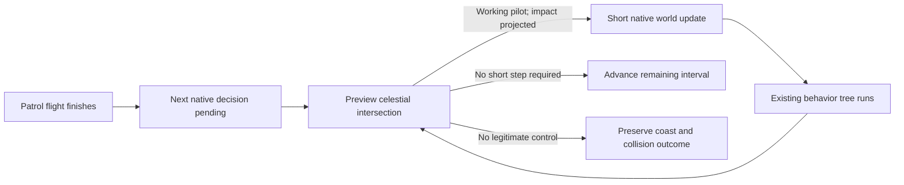

# Celestial impact forecasting and the SFF decision gap

Implemented in Orbital/SFF. The shared call-site hook replaces the world update
in GUI SFF and PASS passenger iterators. A PASS factory wrapper first yields the
native end-turn drain. Neither introduces a saved recovery controller.

## Defect and evidence

In 1.1.0.0, `StarSystem.Update(double)` advances ships before calling
`AIShipManager.FFWD` and `AIShipManager.Update`. The latter dispatches native
`AIShip.RunAI` through `Ostranauts.Ships.AIShipQueue`. One two-hour world update
therefore offers no ship decision turns during those two hours.

`Ostranauts.Ships.AIPilots.NavyPilot` uses the native sticky sequence
`Undock -> TargetNewIfNone -> FlyToPatrol -> Dock`. A completed coordinate patrol
can clear its target before that sequence reaches the next selection. During a
normal frame this is a short transition. Our previous `SffSimulation.Prepare`
could instead propagate that state ballistically for the entire skip and resolve
its impact before the next native decision turn.

The captured O-E3SE/Miserable Code save has a patrol endpoint approximately
22.12 km above Ceres with essentially zero velocity relative to Ceres. This is
not a self-sustaining orbit. Replaying it without guidance reproduces a Ceres
impact in 15 integration steps; guidance toward its saved coordinate survives.
The live SFF receipt also records a 15-step Ceres impact.

The exact command/target at the historical skip's start was not captured.
`targetId: null` meant no hull target, and did not prove there was no coordinate
target. The new receipt distinguishes command-at-start, coordinate-target
presence, actual guidance and impact time. The controlled regression proves a
reachable scheduling defect matching the failure, rather than a complete replay
of every intervening live event. O-326/Karen Kline's death remains separate and
unexplained by this evidence.

## Owning layer

Reviewed native C# includes the world update/queue methods above, the Navy tree,
`FlyToPatrol`, `TargetNewIfNone`, `Undock`, `Dock` and `Ship.NavAIManned`.
`AIShipManager.IsOnCollisionCourse` checks ship obstacles. The existing dodge
repair checks whether a proposed ship-evasion maneuver enters a body; it does
not schedule decisions within a time skip.

The installed `data/condtrigs/condtrigs.json` defines the authoritative
`TIsHumanAwake` pilot condition: forbid Unconscious, IsDead, Stunned and
Recovering; require `TIsHumanOrRobot`. Native star-system JSON supplies body
geometry. Neither asset interface schedules world updates. These assets remain
unchanged; no parallel target-selection or emergency-rescue policy is added.

## Repair and limits

`Orbital/SffAdvance.cs` previews existing SFF trajectories before committing the
world update. A projected celestial impact with an existing region-scheduled
controller, available native pilot and usable RCS thrust selects a world step
no longer than 60 seconds or one quarter of the projected impact time, with a
10 millisecond floor. Coast deadlines use first surface crossing, rather than
the later closest approach used for collision placement.

Prioritize the existing pilot through the native queue, run the original world
update, then forecast again. Once no eligible projected impact requires a short
step, advance toward the next course-completion boundary or six-hour window.
Total skipped time remains exact. Physics,
AI, collisions and economic work run in their normal world-update order; no
actor runs against a temporarily rewound shared world.

### Fractional deadlines and preview cost

The adapter first finds the earliest native course-completion boundary, then
previews only up to that boundary or the six-hour window. An impact inside that
shorter horizon can still select an earlier native decision turn. This avoids
calculating trajectories beyond a world update that must run first; it does not
lower integration resolution or move decisions after a known danger.

`SffDynamics.Propagate` uses `(start + seconds) - start` as its interval, matching
the representable endpoint of native `StarSystem.Update(double)`. With epochs
around 65 billion seconds, fractional deadlines such as 0.02 seconds otherwise
leave a remainder smaller than the absolute clock's precision. The old solver
threw `SFF step below clock resolution` and unnecessarily used native fallback.
The correction changes no force law, authored behavior, fuel policy or save field.

`lastSffAdvance` now includes whole-jump `previewWallMs`, `worldWallMs` and
`elapsedWallMs`, plus preview count and total forecast seconds. These are bounded
scalars in the existing last-jump receipt, require no trace toggle, and are
overwritten by the next skip. World time includes the existing physics, AI and
economic work. The timings exclude GUI/coroutine work outside the world adapter.

The focused timing suite passes 241 checks across different epochs, fractional
durations, coast/powered motion and intervals below clock resolution. Decision
fixtures preserve native arrival, remaining coast, early danger handling and
unconsumed-course protection. A first forecast bounded by a 1,800-second course
completion uses 64 integration steps, versus 255 for the discarded 7,200-second
forecast in the same fixture. That is a deterministic work reduction, not a
prediction of the player's whole-SFF wall-clock improvement.

The scheduler does not assign a target, velocity, fuel, faction, health or
controller. More native decision opportunities during danger are intentional.
Player-containing groups, hidden hulls, locks, gravity-ignore states, combat and
existing native plotted routes retain their existing handling. Unpiloted,
unregistered and thrusterless hulls receive no invented control. Unavoidable
impacts remain possible. This forecasts trajectories owned by the Orbital SFF
adapter, not every native plotted course or normal-time combat maneuver.

Preview does not become `SffSimulation.Current`, publish an actual-SFF receipt,
execute AI, play routes or debit fuel. Temporary lists last only for the skip.
At 512 world steps, remaining native progression is retained and
`budgetFallback` is reported; no crash immunity is granted. `GET /orbital` adds
a bounded `lastSffAdvance` summary, including GUI/PASS source, course boundaries
and original-interval role callback admissions, without persistent save fields or a journal.

## Offline evidence

`Tests/OrbitalCheck/SffDecisionChecks.cs` uses the anonymized captured endpoint
in `Tests/Fixtures/Orbital/PatrolDecisionImpact.json`:

| Case | Result |
| --- | --- |
| One two-hour update before the next patrol decision | Ceres impact before target selection |
| Decision-aware update of the same interval | Two short native turns, then the remainder; original ship/controller survive |
| Missing pilot/controller/thrusters, foreign scheduling region, player, locks, hidden, combat, safe coast, disabled module, non-SFF | No safety steps added |
| World-step exception | Original error propagates; temporary scope released |
| Native iterator hook; changed zero/two-call shapes | Actual patch binds; changed shapes rejected |

The native Navy tree, selector/sticky phases, Undock eligibility, priority queue
dispatch and NavData playback execute under bundled Mono. A queued background
traffic backlog verifies that prioritization reaches the existing pilot; a second
case checks sub-minute deadlines through the production physics-scope prefix.
Pilot eligibility, combat observations,
random target generation and outer world bookkeeping are explicit doubles.
Target generation supplies a course outward on the same side of Ceres; it
does not teleport the ship. This proves the handoff opportunity, not every RNG
choice. The economy harness also compares one six-hour update with
60 + 60 + 21,480 seconds through production world hooks: production, dispatch,
delivery and remaining cargo agree. Existing orbital and economic suites remain
required, including the grazing-conic false-impact controls.

## Behavior-model gap

The graphs described command transitions without composing the time between
them with an hours-long physical update. That was missing coverage. The new
regression joins a native command-phase transition to the physical forecast;
it does not establish complete military/combat/physics coverage.

