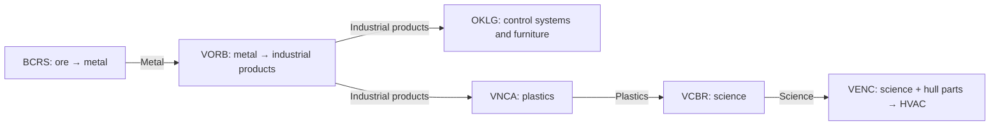

# Station resource production chains

Reference date: 2026-11-06. Derived from the installed Ostranauts market JSON and the local game-code snapshot; this is a configuration reference, not a live stock survey.

## Scope and reading guide

This document covers all **19 installed station cargo-market profiles**, with **240 recipe attachments**. Station labels follow the standard `NewGame` station metadata and cargo-kiosk profile IDs. OFLT is the Flotilla (`OKLG_FLOT`). It does not count runtime copies of actors, prove which actors survive in a particular save, or describe every salvage trader, shop, ferry, or fuel-service inventory.

- All quantities are **market category units**, not kilograms, tonnes, cargo pods, or necessarily identical physical items. A category can contain multiple item definitions.
- All rates are per **game hour**, unlike the real-time encounter-director timers discussed separately. Multiply rates by 24 for game-day totals or 168 for game-week totals.
- Each recipe table gives **inputs and outputs per successful cycle**, cycle frequency, and calculated output/hour. Every listed input is required together; recipes do not select between their input ingredients.
- `None (source)` means the market creates the goods without consuming another market category. This abstracts extraction or other background production; no physical station machine needs to run for that recipe.
- `None (sink)` means goods are consumed and disappear from this market model. These are genuine continuing demand, not trade exports.
- Blank output rate (`—`) indicates a sink. An inactive or blocked recipe produces and consumes nothing.
- Rates are nominal ceilings, assuming enough inputs, output storage, and uninterrupted game-time updates. They are not measured throughput or guaranteed availability.

## How the simulation works

Market configurations specify initial stock, category storage capacities, and recipe lists. `MarketManager.UpdateMarket` checks registered markets roughly every 10 game seconds, including distant markets; proximity to the player is not a requirement in that loop. Each producer schedules elapsed cycles. A successful cycle first verifies all inputs and enough free output capacity, then removes the inputs and adds the output.

**Cycle rate is not always output rate.** The JSON field `fOutputPerHour` is used as cycles/hour by the execution code; the cycle period is `3600 / abs(fOutputPerHour)` seconds. Output per cycle is `max(1, nOutputPerRun)`, with an omitted value effectively becoming 1. Therefore:

```text
input units/hour(category) = cycles/hour × input units/cycle(category)
output units/hour          = cycles/hour × output units/cycle
```

For example, JATL's water source runs 2 cycles/hour and makes 5 water each cycle: **10 water/hour**, not 2. The tables use actual category fields and batch sizes, rather than interpreting recipe names.

Producers run in the order attached to their market actor. They share the ship market's aggregate stock, so recipes compete for the same inputs and can consume goods other recipes just produced. Their all-at-once nominal rates may require imports. The net-import figures below subtract internal output from total input demand; they are theoretical balance calculations, not a scheduling optimizer.

If inputs are missing or output storage is full, production skips that cycle. After checking elapsed cycles, the actor advances the recipe timestamp even if cycles failed. Missed output does not accumulate as an unlimited backlog. Updating in approximately 10-second steps and discarding fractional elapsed intervals can also make actual rates slightly lower than the nominal values.

Player deliveries can restore missing inputs; buying outputs can unblock full storage. The reviewed producer code does not scale cycle frequency with NPC headcount, physical factory condition, electrical power, or player reputation. Those factors should not be assumed to raise the configured rate.

## Station index and gross output

The output list sums every attached producer at its nominal rate, before local consumption. Follow the station links for inputs, conversion yields, and consumption-only recipes.

| Station | Gross output, units/game hour |
| --- | --- |
| [BCER — Port Mojave](#bcer) | Media 1.4; Space Suits 1; Volatiles 3; Water 0.2 |
| [BCRS — Zhonghuamen Terminal](#bcrs) | Hull Parts 1; Metals 8; Ores 2.4; Trash 6.6; Volatiles 1 |
| [EJDR — Port Shajiang](#ejdr) | He3 6.4; Hull Parts 1; Luxury Goods 1.8; Trash 5.4 |
| [HQCH — Qincheng Station](#hqch) | Consumer Goods 1; Metals 0.5; Ores 9; Science 1 |
| [JATL — Atlantis Landing Zone](#jatl) | D2O 3; Fusion Parts 0.5; Life Support Goods 0.5; Science 1.5; Sensor Components 0.5; Water 10 |
| [JFTS — Port Independence](#jfts) | Furniture 5.6; Ores 3.8; Space Suits 2.8; Tools 2.8; Trash 1; Volatiles 1; Weapons 3.8 |
| [JPTN — Porto Nuevo](#jptn) | D2O 1; Furniture 1; Science 0.4; Space Suits 0.2; Tools 1; Volatiles 1 |
| [MHNG — Qiantangmen](#mhng) | Consumer Goods 7.87; Electronics 1; Food 35.35; Intoxicants 1; Life Support Goods 20.61; Science 7.87; Trash 14.74 |
| [MLAB — Royal Carriers Launch Facility](#mlab) | Consumer Goods 5.58; Electronics 7.58; HVAC 4.58; Media 1; Textiles 16.74; Trash 12.16 |
| [MSUZ — Panmen](#msuz) | Electronics 10.2; Food 7.9; Furniture 2.3; Science 1; Space Suits 1; Tools 2.3 |
| [MTRS — Port Yangshan](#mtrs) | Consumer Goods 60; Electronics 56; Food 17; Fusion Parts 82.5; Industrial Products 56; Intoxicants 28.5; Life Support Goods 82.5; Luxury Goods 28.5; Media 5; Medical Items 15; Sensor Components 1; Textiles 28.5 |
| [MVOL — Upsilon Docking](#mvol) | Control Systems 1.4; Fusion Parts 1.4; Hull Parts 1; Industrial Products 3.1; Life Support Goods 1.4; Medical Items 3.5; Sensor Components 0.7; Tools 0.7; Weapons 0.7 |
| [OFLT — Flotilla](#oflt) | Furniture 0.1; Hull Parts 1; Intoxicants 0.2; Trash 1; Weapons 0.1 |
| [OKLG — K-Leg: Port Azikiwe](#oklg) | Control Systems 1; Furniture 0.5; Hull Parts 3.5; Ores 0.5; Sensor Components 0.5 |
| [SVIR — Cassini Spaceport](#svir) | D2O 19.3; He3 19.3; Hull Parts 3; Industrial Products 36.6; Luxury Goods 54.9; Space Suits 3; Trash 41.6; Volatiles 18.3; Water 6.1 |
| [VCBR — Cloudbreak](#vcbr) | HVAC 0.1; Science 1.2 |
| [VENC — Porto do Encantado](#venc) | Hull Parts 1; HVAC 4.6; Luxury Goods 4.6; Media 5.6; Plastics 1; Trash 1 |
| [VNCA — Long Beach Terminal](#vnca) | Consumer Goods 6.9; Hull Parts 1; HVAC 1; Industrial Products 6.9; Intoxicants 1; Life Support Goods 20.7; Media 21.7; Plastics 23.7; Textiles 9.9; Trash 1 |
| [VORB — Venus Orbital](#vorb) | Hull Parts 1; Industrial Products 3 |

## Useful chains and bottlenecks

These examples describe possible material connections, not guaranteed AI routes or profitable trades:



- **VORB:** 1 metal → 1 industrial product at 3 cycles/hour. Maximum output is 72/day or 504/week. Its cargo kiosk starts with a randomized 0–1,000 metal and 0–2,000 industrial products; either category has capacity 3,300. Without metal imports, its initial metal supports at most about 13.9 days of continuous production. Refilling 3,300 industrial products from empty takes at least 45.8 days.
- **OKLG:** all three industrial-product conversion recipes together consume 1.5 industrial products/hour. They produce **1 control system/hour plus 0.5 furniture/hour** in the installed data. The recipe named `OKLGIndustrialProductsToHVACConverter` actually outputs control systems; do not count it as HVAC production.
- **Venus network:** VNCA, VENC, and VCBR declare VORB as their market hub. That affects AI route redirection; it does **not** merge their stock into one shared inventory. Goods still need to move between markets.
- **MTRS:** its fusion-parts recipe alone needs 275 metal/hour, 55 industrial products/hour, and 55 tools/hour to make 82.5 fusion parts/hour. High nominal output does not imply the station can sustain it without imports.

## Configuration quirks preserved in these tables

- `OKLGIndustrialProductsToHVACConverter` says HVAC in its name/description but has `strOutputCollection = AnyControlSystems`. The configured output governs execution.
- `SVIRShipbuildingConsumer` is a conversion, despite its name: hull parts, control systems, furniture, sensors, HVAC, and fusion parts become industrial products.
- Some names omit ingredients: MTRS's metal-to-industrial-products recipe also consumes electronics; MVOL's science/industrial-products fusion-parts recipe also consumes metal. Every ingredient in the JSON is included below.
- Price-demand calculations use `GetDemandPerHourForCategory`, which returns the raw recipe frequency for an output category without multiplying by output batch size. **Displayed price/demand pressure can therefore differ from physical output/hour for multi-output recipes.** The tables below describe stock execution, not those price weights.

## Per-station recipes

<a id="bcer"></a>
### BCER — Port Mojave

Profile: `BCERCargoKiosk`. No explicit `strHubRegId` in this profile.

**Net imports for all recipes to run at their nominal rates (units/hour):** Consumer Goods 0.2; Electronics 1.2; Intoxicants 0.2; Life Support Goods 0.2; Textiles 2; Weapons 0.2.

| Recipe ID | Inputs/cycle | Outputs/cycle | Cycles/hour | Output/hour |
| --- | --- | --- | ---: | ---: |
| `BCERTextilesAndElectronicsToSpaceSuitsConverter` | 1 Electronics + 2 Textiles | 1 Space Suits | 1 | 1 |
| `BCERVolatilesToWaterConverter` | 1 Volatiles | 1 Water | 0.2 | 0.2 |
| `BCERElectronicsToMediaConverter` | 1 Electronics | 1 Media | 0.2 | 0.2 |
| `BCERConsumerGoodsToMediaConverter` | 1 Consumer Goods | 1 Media | 0.2 | 0.2 |
| `BCERLifeSupportConsumer` | 1 Life Support Goods | None (sink) | 0.2 | — |
| `BCERIntoxicantsConsumer` | 1 Intoxicants | None (sink) | 0.2 | — |
| `BCERWeaponsConsumer` | 1 Weapons | None (sink) | 0.2 | — |
| `MediaProducer` | None (source) | 1 Media | 1 | 1 |
| `VolatilesProducerx3` | None (source) | 1 Volatiles | 3 | 3 |

**Category balance at full nominal operation:**

Positive net means a potential export after satisfying local recipes; negative net means imports are needed. Zero means balanced at these rates, but starting stock, recipe order, and storage still matter.

| Category | Consumed/hour | Produced/hour | Net/hour |
| --- | ---: | ---: | ---: |
| Consumer Goods (`AnyConsumerGoods`) | 0.2 | 0 | -0.2 |
| Electronics (`AnyElectronics`) | 1.2 | 0 | -1.2 |
| Intoxicants (`AnyIntoxicants`) | 0.2 | 0 | -0.2 |
| Life Support Goods (`AnyLifeSupport`) | 0.2 | 0 | -0.2 |
| Media (`AnyMedia`) | 0 | 1.4 | +1.4 |
| Space Suits (`AnySpaceSuits`) | 0 | 1 | +1 |
| Textiles (`AnyTextiles`) | 2 | 0 | -2 |
| Volatiles (`AnyVolatiles`) | 0.2 | 3 | +2.8 |
| Water (`AnyWater`) | 0 | 0.2 | +0.2 |
| Weapons (`AnyWeapons`) | 0.2 | 0 | -0.2 |

<a id="bcrs"></a>
### BCRS — Zhonghuamen Terminal

Profile: `BCRSCargoKiosk`. No explicit `strHubRegId` in this profile.

**Net imports for all recipes to run at their nominal rates (units/hour):** Consumer Goods 2.4; D2O 1; Food 2.4; Furniture 1; He3 1; Industrial Products 2.4; Intoxicants 2.4; Life Support Goods 1; Media 2.4; Medical Items 1; Ores 4.6; Water 1; Weapons 1.

| Recipe ID | Inputs/cycle | Outputs/cycle | Cycles/hour | Output/hour |
| --- | --- | --- | ---: | ---: |
| `BCRSOreToMetal` | 1 Ores | 1 Metals | 7 | 7 |
| `BCRSIndustrialProductsToOre` | 1 Industrial Products | 1 Ores | 1.4 | 1.4 |
| `BCRSFoodToTrash` | 1 Food | 1 Trash | 1.4 | 1.4 |
| `BCRSIntoxicantsToTrash` | 1 Intoxicants | 1 Trash | 1.4 | 1.4 |
| `BCRSMediaToTrash` | 1 Media | 1 Trash | 1.4 | 1.4 |
| `BCRSConsumerGoodsToTrash` | 1 Consumer Goods | 1 Trash | 1.4 | 1.4 |
| `ConsumerGoodsConsumer` | 1 Consumer Goods | None (sink) | 1 | — |
| `D2OConsumer` | 1 D2O | None (sink) | 1 | — |
| `FoodConsumer` | 1 Food | None (sink) | 1 | — |
| `FurnitureConsumer` | 1 Furniture | None (sink) | 1 | — |
| `He3Consumer` | 1 He3 | None (sink) | 1 | — |
| `HullConsumer` | None (source) | 1 Hull Parts | 1 | 1 |
| `LifeSupportConsumer` | 1 Life Support Goods | None (sink) | 1 | — |
| `IntoxicantsConsumer` | 1 Intoxicants | None (sink) | 1 | — |
| `MediaConsumer` | 1 Media | None (sink) | 1 | — |
| `MedicalConsumer` | 1 Medical Items | None (sink) | 1 | — |
| `WaterConsumer` | 1 Water | None (sink) | 1 | — |
| `WeaponsConsumer` | 1 Weapons | None (sink) | 1 | — |
| `TrashProducer` | None (source) | 1 Trash | 1 | 1 |
| `OreProducer` | None (source) | 1 Ores | 1 | 1 |
| `VolatilesProducer` | None (source) | 1 Volatiles | 1 | 1 |
| `IndustrialProductsConsumer` | 1 Industrial Products | None (sink) | 1 | — |
| `MetalProducer` | None (source) | 1 Metals | 1 | 1 |

**Category balance at full nominal operation:**

Positive net means a potential export after satisfying local recipes; negative net means imports are needed. Zero means balanced at these rates, but starting stock, recipe order, and storage still matter.

| Category | Consumed/hour | Produced/hour | Net/hour |
| --- | ---: | ---: | ---: |
| Consumer Goods (`AnyConsumerGoods`) | 2.4 | 0 | -2.4 |
| D2O (`AnyD2O`) | 1 | 0 | -1 |
| Food (`AnyFood`) | 2.4 | 0 | -2.4 |
| Furniture (`AnyFurniture`) | 1 | 0 | -1 |
| He3 (`AnyHe3`) | 1 | 0 | -1 |
| Hull Parts (`AnyHull`) | 0 | 1 | +1 |
| Industrial Products (`AnyIndustrialProducts`) | 2.4 | 0 | -2.4 |
| Intoxicants (`AnyIntoxicants`) | 2.4 | 0 | -2.4 |
| Life Support Goods (`AnyLifeSupport`) | 1 | 0 | -1 |
| Media (`AnyMedia`) | 2.4 | 0 | -2.4 |
| Medical Items (`AnyMedical`) | 1 | 0 | -1 |
| Metals (`AnyMetal`) | 0 | 8 | +8 |
| Ores (`AnyOres`) | 7 | 2.4 | -4.6 |
| Trash (`AnyTrash`) | 0 | 6.6 | +6.6 |
| Volatiles (`AnyVolatiles`) | 0 | 1 | +1 |
| Water (`AnyWater`) | 1 | 0 | -1 |
| Weapons (`AnyWeapons`) | 1 | 0 | -1 |

<a id="ejdr"></a>
### EJDR — Port Shajiang

Profile: `EJDRCargoKiosk`. No explicit `strHubRegId` in this profile.

**Net imports for all recipes to run at their nominal rates (units/hour):** Consumer Goods 1.8; Food 1.8; Industrial Products 1.8; Intoxicants 1.8; Life Support Goods 1; Luxury Goods 1; Media 2.8; Water 1.

| Recipe ID | Inputs/cycle | Outputs/cycle | Cycles/hour | Output/hour |
| --- | --- | --- | ---: | ---: |
| `HullConsumer` | None (source) | 1 Hull Parts | 1 | 1 |
| `LifeSupportConsumer` | 1 Life Support Goods | None (sink) | 1 | — |
| `LuxuryGoodsConsumer` | 1 Luxury Goods | None (sink) | 1 | — |
| `MediaConsumer` | 1 Media | None (sink) | 1 | — |
| `WaterConsumer` | 1 Water | None (sink) | 1 | — |
| `He3Producer` | None (source) | 1 He3 | 1 | 1 |
| `EJDRFoodAndIndustrialGoodsToHe3Converter` | 1 Food + 1 Industrial Products | 3 He3 | 1.8 | 5.4 |
| `EJDRMediaToLuxuryGoodsConverter` | 1 Media | 1 Luxury Goods | 1.8 | 1.8 |
| `EJDRLuxuryGoodsToTrashConverter` | 1 Luxury Goods | 1 Trash | 1.8 | 1.8 |
| `EJDRIntoxicantsToTrashConverter` | 1 Intoxicants | 1 Trash | 1.8 | 1.8 |
| `EJDRConsumerGoodsToTrashConverter` | 1 Consumer Goods | 1 Trash | 1.8 | 1.8 |

**Category balance at full nominal operation:**

Positive net means a potential export after satisfying local recipes; negative net means imports are needed. Zero means balanced at these rates, but starting stock, recipe order, and storage still matter.

| Category | Consumed/hour | Produced/hour | Net/hour |
| --- | ---: | ---: | ---: |
| Consumer Goods (`AnyConsumerGoods`) | 1.8 | 0 | -1.8 |
| Food (`AnyFood`) | 1.8 | 0 | -1.8 |
| He3 (`AnyHe3`) | 0 | 6.4 | +6.4 |
| Hull Parts (`AnyHull`) | 0 | 1 | +1 |
| Industrial Products (`AnyIndustrialProducts`) | 1.8 | 0 | -1.8 |
| Intoxicants (`AnyIntoxicants`) | 1.8 | 0 | -1.8 |
| Life Support Goods (`AnyLifeSupport`) | 1 | 0 | -1 |
| Luxury Goods (`AnyLuxuryGoods`) | 2.8 | 1.8 | -1 |
| Media (`AnyMedia`) | 2.8 | 0 | -2.8 |
| Trash (`AnyTrash`) | 0 | 5.4 | +5.4 |
| Water (`AnyWater`) | 1 | 0 | -1 |

<a id="hqch"></a>
### HQCH — Qincheng Station

Profile: `HQCHCargoKiosk`. No explicit `strHubRegId` in this profile.

**Net imports for all recipes to run at their nominal rates (units/hour):** Food 0.5; Industrial Products 1; Intoxicants 1; Life Support Goods 0.5; Medical Items 0.5; Tools 1; Trash 7.5; Weapons 0.5.

| Recipe ID | Inputs/cycle | Outputs/cycle | Cycles/hour | Output/hour |
| --- | --- | --- | ---: | ---: |
| `HQCHTrashToConsumerGoodsConverter` | 5 Trash | 1 Consumer Goods | 1 | 1 |
| `HQCHTrashToMetalConverter` | 5 Trash | 1 Metals | 0.5 | 0.5 |
| `HQCHMedicalToScienceConverter` | 1 Medical Items | 1 Science | 0.5 | 0.5 |
| `HQCHWeaponsToScienceConverter` | 1 Weapons | 1 Science | 0.5 | 0.5 |
| `HQCHToolsToOresConverter` | 1 Tools | 2 Ores | 1 | 2 |
| `HQCHIndustrialProductsToOresConverter` | 1 Industrial Products | 4 Ores | 1 | 4 |
| `HQCHFoodConsumer` | 1 Food | None (sink) | 0.5 | — |
| `HQCHLifeSupportConsumer` | 1 Life Support Goods | None (sink) | 0.5 | — |
| `IntoxicantsConsumer` | 1 Intoxicants | None (sink) | 1 | — |
| `OreProducerx3` | None (source) | 1 Ores | 3 | 3 |

**Category balance at full nominal operation:**

Positive net means a potential export after satisfying local recipes; negative net means imports are needed. Zero means balanced at these rates, but starting stock, recipe order, and storage still matter.

| Category | Consumed/hour | Produced/hour | Net/hour |
| --- | ---: | ---: | ---: |
| Consumer Goods (`AnyConsumerGoods`) | 0 | 1 | +1 |
| Food (`AnyFood`) | 0.5 | 0 | -0.5 |
| Industrial Products (`AnyIndustrialProducts`) | 1 | 0 | -1 |
| Intoxicants (`AnyIntoxicants`) | 1 | 0 | -1 |
| Life Support Goods (`AnyLifeSupport`) | 0.5 | 0 | -0.5 |
| Medical Items (`AnyMedical`) | 0.5 | 0 | -0.5 |
| Metals (`AnyMetal`) | 0 | 0.5 | +0.5 |
| Ores (`AnyOres`) | 0 | 9 | +9 |
| Science (`AnyScience`) | 0 | 1 | +1 |
| Tools (`AnyTools`) | 1 | 0 | -1 |
| Trash (`AnyTrash`) | 7.5 | 0 | -7.5 |
| Weapons (`AnyWeapons`) | 0.5 | 0 | -0.5 |

<a id="jatl"></a>
### JATL — Atlantis Landing Zone

Profile: `JATLCargoKiosk`. No explicit `strHubRegId` in this profile.

**Net imports for all recipes to run at their nominal rates (units/hour):** Electronics 2; HVAC 0.5; Industrial Products 0.5; Medical Items 0.5; Metals 0.5.

| Recipe ID | Inputs/cycle | Outputs/cycle | Cycles/hour | Output/hour |
| --- | --- | --- | ---: | ---: |
| `JATLWaterProducer` | None (source) | 5 Water | 2 | 10 |
| `JATLWaterToScienceConverter` | 1 Water | 2 Science | 0.5 | 1 |
| `JATLMedicalToScienceConverter` | 1 Medical Items | 1 Science | 0.5 | 0.5 |
| `JATLWaterToLifeSupportConverter` | 1 Water | 1 Life Support Goods | 0.5 | 0.5 |
| `JATLElectronicsToSensorsConverter` | 1 Electronics | 1 Sensor Components | 0.5 | 0.5 |
| `JATLElectronicsHVACMetalAndIndustrialProductsToFusionPartsConverter` | 3 Electronics + 1 HVAC + 1 Metals + 1 Industrial Products | 1 Fusion Parts | 0.5 | 0.5 |
| `D2OProducerx3` | None (source) | 1 D2O | 3 | 3 |

**Category balance at full nominal operation:**

Positive net means a potential export after satisfying local recipes; negative net means imports are needed. Zero means balanced at these rates, but starting stock, recipe order, and storage still matter.

| Category | Consumed/hour | Produced/hour | Net/hour |
| --- | ---: | ---: | ---: |
| D2O (`AnyD2O`) | 0 | 3 | +3 |
| Electronics (`AnyElectronics`) | 2 | 0 | -2 |
| Fusion Parts (`AnyFusionParts`) | 0 | 0.5 | +0.5 |
| HVAC (`AnyHVAC`) | 0.5 | 0 | -0.5 |
| Industrial Products (`AnyIndustrialProducts`) | 0.5 | 0 | -0.5 |
| Life Support Goods (`AnyLifeSupport`) | 0 | 0.5 | +0.5 |
| Medical Items (`AnyMedical`) | 0.5 | 0 | -0.5 |
| Metals (`AnyMetal`) | 0.5 | 0 | -0.5 |
| Science (`AnyScience`) | 0 | 1.5 | +1.5 |
| Sensor Components (`AnySensors`) | 0 | 0.5 | +0.5 |
| Water (`AnyWater`) | 1 | 10 | +9 |

<a id="jfts"></a>
### JFTS — Port Independence

Profile: `JFTSCargoKiosk`. No explicit `strHubRegId` in this profile.

**Net imports for all recipes to run at their nominal rates (units/hour):** Consumer Goods 1; Electronics 2.8; Industrial Products 2.8; Media 1; Medical Items 3; Metals 14; Plastics 5.6; Textiles 5.6; Water 1.

| Recipe ID | Inputs/cycle | Outputs/cycle | Cycles/hour | Output/hour |
| --- | --- | --- | ---: | ---: |
| `JFTSPlasticsAndMetalToFurnitureConverter` | 1 Plastics + 2 Metals | 1 Furniture | 5.6 | 5.6 |
| `JFTSTextilesAndElectronicsToSpaceSuitsConverter` | 1 Electronics + 2 Textiles | 1 Space Suits | 2.8 | 2.8 |
| `JFTSIndustrialProductsToToolsConverter` | 1 Industrial Products | 1 Tools | 2.8 | 2.8 |
| `JFTSOreProducer` | None (source) | 1 Ores | 2.8 | 2.8 |
| `JFTSMetalToWeaponsConverter` | 1 Metals | 1 Weapons | 2.8 | 2.8 |
| `ConsumerGoodsConsumer` | 1 Consumer Goods | None (sink) | 1 | — |
| `MediaConsumer` | 1 Media | None (sink) | 1 | — |
| `MedicalConsumerx3` | 1 Medical Items | None (sink) | 3 | — |
| `WaterConsumer` | 1 Water | None (sink) | 1 | — |
| `OreProducer` | None (source) | 1 Ores | 1 | 1 |
| `VolatilesProducer` | None (source) | 1 Volatiles | 1 | 1 |
| `TrashProducer` | None (source) | 1 Trash | 1 | 1 |
| `WeaponsProducer` | None (source) | 1 Weapons | 1 | 1 |

**Category balance at full nominal operation:**

Positive net means a potential export after satisfying local recipes; negative net means imports are needed. Zero means balanced at these rates, but starting stock, recipe order, and storage still matter.

| Category | Consumed/hour | Produced/hour | Net/hour |
| --- | ---: | ---: | ---: |
| Consumer Goods (`AnyConsumerGoods`) | 1 | 0 | -1 |
| Electronics (`AnyElectronics`) | 2.8 | 0 | -2.8 |
| Furniture (`AnyFurniture`) | 0 | 5.6 | +5.6 |
| Industrial Products (`AnyIndustrialProducts`) | 2.8 | 0 | -2.8 |
| Media (`AnyMedia`) | 1 | 0 | -1 |
| Medical Items (`AnyMedical`) | 3 | 0 | -3 |
| Metals (`AnyMetal`) | 14 | 0 | -14 |
| Ores (`AnyOres`) | 0 | 3.8 | +3.8 |
| Plastics (`AnyPlastics`) | 5.6 | 0 | -5.6 |
| Space Suits (`AnySpaceSuits`) | 0 | 2.8 | +2.8 |
| Textiles (`AnyTextiles`) | 5.6 | 0 | -5.6 |
| Tools (`AnyTools`) | 0 | 2.8 | +2.8 |
| Trash (`AnyTrash`) | 0 | 1 | +1 |
| Volatiles (`AnyVolatiles`) | 0 | 1 | +1 |
| Water (`AnyWater`) | 1 | 0 | -1 |
| Weapons (`AnyWeapons`) | 0 | 3.8 | +3.8 |

<a id="jptn"></a>
### JPTN — Porto Nuevo

Profile: `JPTNCargoKiosk`. No explicit `strHubRegId` in this profile.

**Net imports for all recipes to run at their nominal rates (units/hour):** Electronics 0.2; HVAC 0.2; Industrial Products 0.2; Media 1; Metals 1; Textiles 0.2.

| Recipe ID | Inputs/cycle | Outputs/cycle | Cycles/hour | Output/hour |
| --- | --- | --- | ---: | ---: |
| `JPTNMetalToFurniture` | 1 Metals | 1 Furniture | 1 | 1 |
| `JPTNTextilesAndElectronicsToSpaceSuits` | 1 Textiles + 1 Electronics | 1 Space Suits | 0.2 | 0.2 |
| `JPTNHVACAndIndustrialProductsToScience` | 1 HVAC + 1 Industrial Products | 2 Science | 0.2 | 0.4 |
| `MediaConsumer` | 1 Media | None (sink) | 1 | — |
| `D2OProducer` | None (source) | 1 D2O | 1 | 1 |
| `VolatilesProducer` | None (source) | 1 Volatiles | 1 | 1 |
| `ToolsProducer` | None (source) | 1 Tools | 1 | 1 |

**Category balance at full nominal operation:**

Positive net means a potential export after satisfying local recipes; negative net means imports are needed. Zero means balanced at these rates, but starting stock, recipe order, and storage still matter.

| Category | Consumed/hour | Produced/hour | Net/hour |
| --- | ---: | ---: | ---: |
| D2O (`AnyD2O`) | 0 | 1 | +1 |
| Electronics (`AnyElectronics`) | 0.2 | 0 | -0.2 |
| Furniture (`AnyFurniture`) | 0 | 1 | +1 |
| HVAC (`AnyHVAC`) | 0.2 | 0 | -0.2 |
| Industrial Products (`AnyIndustrialProducts`) | 0.2 | 0 | -0.2 |
| Media (`AnyMedia`) | 1 | 0 | -1 |
| Metals (`AnyMetal`) | 1 | 0 | -1 |
| Science (`AnyScience`) | 0 | 0.4 | +0.4 |
| Space Suits (`AnySpaceSuits`) | 0 | 0.2 | +0.2 |
| Textiles (`AnyTextiles`) | 0.2 | 0 | -0.2 |
| Tools (`AnyTools`) | 0 | 1 | +1 |
| Volatiles (`AnyVolatiles`) | 0 | 1 | +1 |

<a id="mhng"></a>
### MHNG — Qiantangmen

Profile: `MHNGCargoKiosk`. No explicit `strHubRegId` in this profile.

**Net imports for all recipes to run at their nominal rates (units/hour):** Luxury Goods 9.87; Media 7.87; Medical Items 9.87; Textiles 7.87; Volatiles 6.87; Water 6.87.

| Recipe ID | Inputs/cycle | Outputs/cycle | Cycles/hour | Output/hour |
| --- | --- | --- | ---: | ---: |
| `MediaConsumer` | 1 Media | None (sink) | 1 | — |
| `MedicalConsumerx3` | 1 Medical Items | None (sink) | 3 | — |
| `TextilesConsumer` | 1 Textiles | None (sink) | 1 | — |
| `LuxuryGoodsConsumerx3` | 1 Luxury Goods | None (sink) | 3 | — |
| `FoodProducer` | None (source) | 1 Food | 1 | 1 |
| `ScienceProducer` | None (source) | 1 Science | 1 | 1 |
| `TrashProducer` | None (source) | 1 Trash | 1 | 1 |
| `ConsumerGoodsProducer` | None (source) | 1 Consumer Goods | 1 | 1 |
| `ElectronicsProducer` | None (source) | 1 Electronics | 1 | 1 |
| `IntoxicantsProducer` | None (source) | 1 Intoxicants | 1 | 1 |
| `MHNGWaterToFoodConverter` | 1 Water | 5 Food | 6.87 | 34.35 |
| `MHNGVolatilesToLifeSupportConverter` | 1 Volatiles | 3 Life Support Goods | 6.87 | 20.61 |
| `MHNGLuxuryGoodsToTrashConverter` | 1 Luxury Goods | 1 Trash | 6.87 | 6.87 |
| `MHNGMediaToScienceConverter` | 1 Media | 1 Science | 6.87 | 6.87 |
| `MHNGTextilesToConsumerGoodsConverter` | 1 Textiles | 1 Consumer Goods | 6.87 | 6.87 |
| `MHNGMedicalToTrashConverter` | 1 Medical Items | 1 Trash | 6.87 | 6.87 |

**Category balance at full nominal operation:**

Positive net means a potential export after satisfying local recipes; negative net means imports are needed. Zero means balanced at these rates, but starting stock, recipe order, and storage still matter.

| Category | Consumed/hour | Produced/hour | Net/hour |
| --- | ---: | ---: | ---: |
| Consumer Goods (`AnyConsumerGoods`) | 0 | 7.87 | +7.87 |
| Electronics (`AnyElectronics`) | 0 | 1 | +1 |
| Food (`AnyFood`) | 0 | 35.35 | +35.35 |
| Intoxicants (`AnyIntoxicants`) | 0 | 1 | +1 |
| Life Support Goods (`AnyLifeSupport`) | 0 | 20.61 | +20.61 |
| Luxury Goods (`AnyLuxuryGoods`) | 9.87 | 0 | -9.87 |
| Media (`AnyMedia`) | 7.87 | 0 | -7.87 |
| Medical Items (`AnyMedical`) | 9.87 | 0 | -9.87 |
| Science (`AnyScience`) | 0 | 7.87 | +7.87 |
| Textiles (`AnyTextiles`) | 7.87 | 0 | -7.87 |
| Trash (`AnyTrash`) | 0 | 14.74 | +14.74 |
| Volatiles (`AnyVolatiles`) | 6.87 | 0 | -6.87 |
| Water (`AnyWater`) | 6.87 | 0 | -6.87 |

<a id="mlab"></a>
### MLAB — Royal Carriers Launch Facility

Profile: `MLABCargoKiosk`. No explicit `strHubRegId` in this profile.

**Net imports for all recipes to run at their nominal rates (units/hour):** Food 16.74; Industrial Products 10.16; Media 3.58; Medical Items 5.58.

| Recipe ID | Inputs/cycle | Outputs/cycle | Cycles/hour | Output/hour |
| --- | --- | --- | ---: | ---: |
| `FoodConsumerx3` | 1 Food | None (sink) | 3 | — |
| `IndustrialProductsConsumer` | 1 Industrial Products | None (sink) | 1 | — |
| `MediaProducer` | None (source) | 1 Media | 1 | 1 |
| `MedicalConsumer` | 1 Medical Items | None (sink) | 1 | — |
| `ConsumerGoodsProducer` | None (source) | 1 Consumer Goods | 1 | 1 |
| `ElectronicsProducerx3` | None (source) | 1 Electronics | 3 | 3 |
| `TextilesProducerx3` | None (source) | 1 Textiles | 3 | 3 |
| `TrashProducerx3` | None (source) | 1 Trash | 3 | 3 |
| `MLABFoodToTextilesConverter` | 1 Food | 3 Textiles | 4.58 | 13.74 |
| `MLABFoodToConsumerGoodsConverter` | 1 Food | 1 Consumer Goods | 4.58 | 4.58 |
| `MLABIndustrialProductsToElectronicsConverter` | 1 Industrial Products | 1 Electronics | 4.58 | 4.58 |
| `MLABIndustrialProductsToHVACConverter` | 1 Industrial Products | 1 HVAC | 4.58 | 4.58 |
| `MLABMedicalToTrashConverter` | 1 Medical Items | 1 Trash | 4.58 | 4.58 |
| `MLABFoodToTrashConverter` | 1 Food | 1 Trash | 4.58 | 4.58 |
| `MLABConsumeMedia` | 1 Media | None (sink) | 4.58 | — |

**Category balance at full nominal operation:**

Positive net means a potential export after satisfying local recipes; negative net means imports are needed. Zero means balanced at these rates, but starting stock, recipe order, and storage still matter.

| Category | Consumed/hour | Produced/hour | Net/hour |
| --- | ---: | ---: | ---: |
| Consumer Goods (`AnyConsumerGoods`) | 0 | 5.58 | +5.58 |
| Electronics (`AnyElectronics`) | 0 | 7.58 | +7.58 |
| Food (`AnyFood`) | 16.74 | 0 | -16.74 |
| HVAC (`AnyHVAC`) | 0 | 4.58 | +4.58 |
| Industrial Products (`AnyIndustrialProducts`) | 10.16 | 0 | -10.16 |
| Media (`AnyMedia`) | 4.58 | 1 | -3.58 |
| Medical Items (`AnyMedical`) | 5.58 | 0 | -5.58 |
| Textiles (`AnyTextiles`) | 0 | 16.74 | +16.74 |
| Trash (`AnyTrash`) | 0 | 12.16 | +12.16 |

<a id="msuz"></a>
### MSUZ — Panmen

Profile: `MSUZCargoKiosk`. No explicit `strHubRegId` in this profile.

**Net imports for all recipes to run at their nominal rates (units/hour):** Industrial Products 4.6; Metals 2.3; Plastics 2.3; Water 2.3.

| Recipe ID | Inputs/cycle | Outputs/cycle | Cycles/hour | Output/hour |
| --- | --- | --- | ---: | ---: |
| `FoodProducer` | None (source) | 1 Food | 1 | 1 |
| `ScienceProducer` | None (source) | 1 Science | 1 | 1 |
| `ElectronicsProducer` | None (source) | 1 Electronics | 1 | 1 |
| `SpaceSuitsProducer` | None (source) | 1 Space Suits | 1 | 1 |
| `MSUZWaterToFoodConverter` | 1 Water | 3 Food | 2.3 | 6.9 |
| `MSUZPlasticsAndMetalsToElectronicsConverter` | 1 Plastics + 1 Metals | 4 Electronics | 2.3 | 9.2 |
| `MSUZIndustrialProductsToFurnitureConverter` | 1 Industrial Products | 1 Furniture | 2.3 | 2.3 |
| `MSUZIndustrialProductsToToolsConverter` | 1 Industrial Products | 1 Tools | 2.3 | 2.3 |

**Category balance at full nominal operation:**

Positive net means a potential export after satisfying local recipes; negative net means imports are needed. Zero means balanced at these rates, but starting stock, recipe order, and storage still matter.

| Category | Consumed/hour | Produced/hour | Net/hour |
| --- | ---: | ---: | ---: |
| Electronics (`AnyElectronics`) | 0 | 10.2 | +10.2 |
| Food (`AnyFood`) | 0 | 7.9 | +7.9 |
| Furniture (`AnyFurniture`) | 0 | 2.3 | +2.3 |
| Industrial Products (`AnyIndustrialProducts`) | 4.6 | 0 | -4.6 |
| Metals (`AnyMetal`) | 2.3 | 0 | -2.3 |
| Plastics (`AnyPlastics`) | 2.3 | 0 | -2.3 |
| Science (`AnyScience`) | 0 | 1 | +1 |
| Space Suits (`AnySpaceSuits`) | 0 | 1 | +1 |
| Tools (`AnyTools`) | 0 | 2.3 | +2.3 |
| Water (`AnyWater`) | 2.3 | 0 | -2.3 |

<a id="mtrs"></a>
### MTRS — Port Yangshan

Profile: `MTRSCargoKiosk`. No explicit `strHubRegId` in this profile.

**Net imports for all recipes to run at their nominal rates (units/hour):** D2O 1; Electronics 26.5; He3 1; Metals 357.5; Plastics 110; Tools 55; Volatiles 27.5; Water 42.5; Weapons 1.

| Recipe ID | Inputs/cycle | Outputs/cycle | Cycles/hour | Output/hour |
| --- | --- | --- | ---: | ---: |
| `ElectronicsProducer` | None (source) | 1 Electronics | 1 | 1 |
| `LuxuryGoodsProducer` | None (source) | 1 Luxury Goods | 1 | 1 |
| `IntoxicantsProducer` | None (source) | 1 Intoxicants | 1 | 1 |
| `FoodProducerx3` | None (source) | 1 Food | 3 | 3 |
| `MediaProducerx5` | None (source) | 1 Media | 5 | 5 |
| `MedicalProducer` | None (source) | 1 Medical Items | 1 | 1 |
| `ConsumerGoodsProducerx5` | None (source) | 1 Consumer Goods | 5 | 5 |
| `TextilesProducer` | None (source) | 1 Textiles | 1 | 1 |
| `IndustrialProductsProducer` | None (source) | 1 Industrial Products | 1 | 1 |
| `SensorsProducer` | None (source) | 1 Sensor Components | 1 | 1 |
| `WaterConsumer` | 1 Water | None (sink) | 1 | — |
| `WeaponsConsumer` | 1 Weapons | None (sink) | 1 | — |
| `He3Consumer` | 1 He3 | None (sink) | 1 | — |
| `D2OConsumer` | 1 D2O | None (sink) | 1 | — |
| `MTRSElectronicsToConsumerGoodsConverter` | 1 Electronics | 1 Consumer Goods | 27.5 | 27.5 |
| `MTRSIntoxicantsToMedicalConverter` | 1 Intoxicants | 1 Medical Items | 14 | 14 |
| `MTRSMetalsAndIndustrialProductsAndToolsToFusionPartsConverter` | 10 Metals + 2 Industrial Products + 2 Tools | 3 Fusion Parts | 27.5 | 82.5 |
| `MTRSMetalsToIndustrialProductsConverter` | 1 Metals + 1 Electronics | 2 Industrial Products | 27.5 | 55 |
| `MTRSPlasticsAndMetalsToElectronicsConverter` | 1 Plastics + 1 Metals | 2 Electronics | 27.5 | 55 |
| `MTRSPlasticsAndMetalsToLuxuryGoodsConverter` | 1 Plastics + 1 Metals + 1 Electronics | 1 Luxury Goods | 27.5 | 27.5 |
| `MTRSPlasticsToConsumerGoodsConverter` | 1 Plastics | 1 Consumer Goods | 27.5 | 27.5 |
| `MTRSPlasticsToTextilesConverter` | 1 Plastics | 1 Textiles | 27.5 | 27.5 |
| `MTRSVolatilesToLifeSupportConverter` | 1 Volatiles | 3 Life Support Goods | 27.5 | 82.5 |
| `MTRSWaterToIntoxicantsConverter` | 1 Water | 1 Intoxicants | 27.5 | 27.5 |
| `MTRSWaterToFoodConverter` | 1 Water | 1 Food | 14 | 14 |

**Category balance at full nominal operation:**

Positive net means a potential export after satisfying local recipes; negative net means imports are needed. Zero means balanced at these rates, but starting stock, recipe order, and storage still matter.

| Category | Consumed/hour | Produced/hour | Net/hour |
| --- | ---: | ---: | ---: |
| Consumer Goods (`AnyConsumerGoods`) | 0 | 60 | +60 |
| D2O (`AnyD2O`) | 1 | 0 | -1 |
| Electronics (`AnyElectronics`) | 82.5 | 56 | -26.5 |
| Food (`AnyFood`) | 0 | 17 | +17 |
| Fusion Parts (`AnyFusionParts`) | 0 | 82.5 | +82.5 |
| He3 (`AnyHe3`) | 1 | 0 | -1 |
| Industrial Products (`AnyIndustrialProducts`) | 55 | 56 | +1 |
| Intoxicants (`AnyIntoxicants`) | 14 | 28.5 | +14.5 |
| Life Support Goods (`AnyLifeSupport`) | 0 | 82.5 | +82.5 |
| Luxury Goods (`AnyLuxuryGoods`) | 0 | 28.5 | +28.5 |
| Media (`AnyMedia`) | 0 | 5 | +5 |
| Medical Items (`AnyMedical`) | 0 | 15 | +15 |
| Metals (`AnyMetal`) | 357.5 | 0 | -357.5 |
| Plastics (`AnyPlastics`) | 110 | 0 | -110 |
| Sensor Components (`AnySensors`) | 0 | 1 | +1 |
| Textiles (`AnyTextiles`) | 0 | 28.5 | +28.5 |
| Tools (`AnyTools`) | 55 | 0 | -55 |
| Volatiles (`AnyVolatiles`) | 27.5 | 0 | -27.5 |
| Water (`AnyWater`) | 42.5 | 0 | -42.5 |
| Weapons (`AnyWeapons`) | 1 | 0 | -1 |

<a id="mvol"></a>
### MVOL — Upsilon Docking

Profile: `MVOLCargoKiosk`. No explicit `strHubRegId` in this profile.

**Net imports for all recipes to run at their nominal rates (units/hour):** Electronics 1.4; Metals 4.2; Plastics 0.7; Science 3.5; Volatiles 0.7.

| Recipe ID | Inputs/cycle | Outputs/cycle | Cycles/hour | Output/hour |
| --- | --- | --- | ---: | ---: |
| `HullConsumer` | None (source) | 1 Hull Parts | 1 | 1 |
| `IndustrialProductsProducer` | None (source) | 1 Industrial Products | 1 | 1 |
| `MVOLScienceToMedicalConverter` | 1 Science | 5 Medical Items | 0.7 | 3.5 |
| `MVOLScienceToIndustrialProductsConverter` | 1 Science | 3 Industrial Products | 0.7 | 2.1 |
| `MVOLScienceToControlSystemsConverter` | 1 Science | 1 Control Systems | 0.7 | 0.7 |
| `MVOLPlasticsToControlSystemsConverter` | 1 Plastics | 1 Control Systems | 0.7 | 0.7 |
| `MVOLMetalToWeaponsConverter` | 1 Metals | 1 Weapons | 0.7 | 0.7 |
| `MVOLElectronicsToToolsConverter` | 1 Electronics | 1 Tools | 0.7 | 0.7 |
| `MVOLElectronicsToSensorsConverter` | 1 Electronics | 1 Sensor Components | 0.7 | 0.7 |
| `MVOLVolatilesToLifeSupportConverter` | 1 Volatiles | 2 Life Support Goods | 0.7 | 1.4 |
| `MVOLScienceAndIndustrialProductsToFusionPartsConverter` | 5 Metals + 2 Science + 2 Industrial Products | 2 Fusion Parts | 0.7 | 1.4 |

**Category balance at full nominal operation:**

Positive net means a potential export after satisfying local recipes; negative net means imports are needed. Zero means balanced at these rates, but starting stock, recipe order, and storage still matter.

| Category | Consumed/hour | Produced/hour | Net/hour |
| --- | ---: | ---: | ---: |
| Control Systems (`AnyControlSystems`) | 0 | 1.4 | +1.4 |
| Electronics (`AnyElectronics`) | 1.4 | 0 | -1.4 |
| Fusion Parts (`AnyFusionParts`) | 0 | 1.4 | +1.4 |
| Hull Parts (`AnyHull`) | 0 | 1 | +1 |
| Industrial Products (`AnyIndustrialProducts`) | 1.4 | 3.1 | +1.7 |
| Life Support Goods (`AnyLifeSupport`) | 0 | 1.4 | +1.4 |
| Medical Items (`AnyMedical`) | 0 | 3.5 | +3.5 |
| Metals (`AnyMetal`) | 4.2 | 0 | -4.2 |
| Plastics (`AnyPlastics`) | 0.7 | 0 | -0.7 |
| Science (`AnyScience`) | 3.5 | 0 | -3.5 |
| Sensor Components (`AnySensors`) | 0 | 0.7 | +0.7 |
| Tools (`AnyTools`) | 0 | 0.7 | +0.7 |
| Volatiles (`AnyVolatiles`) | 0.7 | 0 | -0.7 |
| Weapons (`AnyWeapons`) | 0 | 0.7 | +0.7 |

<a id="oflt"></a>
### OFLT — Flotilla

Profile: `OFLTCargoKiosk`. No explicit `strHubRegId` in this profile.

**Net imports for all recipes to run at their nominal rates (units/hour):** Food 1; Life Support Goods 1; Trash 0.5; Water 1.1.

| Recipe ID | Inputs/cycle | Outputs/cycle | Cycles/hour | Output/hour |
| --- | --- | --- | ---: | ---: |
| `OFLTWaterToIntoxicantsConverter` | 1 Water | 1 Intoxicants | 0.1 | 0.1 |
| `OFLTTrashToIntoxicantsConverter` | 5 Trash | 1 Intoxicants | 0.1 | 0.1 |
| `OFLTTrashToFurnitureConverter` | 5 Trash | 1 Furniture | 0.1 | 0.1 |
| `OFLTTrashToWeaponsConverter` | 5 Trash | 1 Weapons | 0.1 | 0.1 |
| `FoodConsumer` | 1 Food | None (sink) | 1 | — |
| `LifeSupportConsumer` | 1 Life Support Goods | None (sink) | 1 | — |
| `WaterConsumer` | 1 Water | None (sink) | 1 | — |
| `HullConsumer` | None (source) | 1 Hull Parts | 1 | 1 |
| `TrashProducer` | None (source) | 1 Trash | 1 | 1 |

**Category balance at full nominal operation:**

Positive net means a potential export after satisfying local recipes; negative net means imports are needed. Zero means balanced at these rates, but starting stock, recipe order, and storage still matter.

| Category | Consumed/hour | Produced/hour | Net/hour |
| --- | ---: | ---: | ---: |
| Food (`AnyFood`) | 1 | 0 | -1 |
| Furniture (`AnyFurniture`) | 0 | 0.1 | +0.1 |
| Hull Parts (`AnyHull`) | 0 | 1 | +1 |
| Intoxicants (`AnyIntoxicants`) | 0 | 0.2 | +0.2 |
| Life Support Goods (`AnyLifeSupport`) | 1 | 0 | -1 |
| Trash (`AnyTrash`) | 1.5 | 1 | -0.5 |
| Water (`AnyWater`) | 1.1 | 0 | -1.1 |
| Weapons (`AnyWeapons`) | 0 | 0.1 | +0.1 |

<a id="oklg"></a>
### OKLG — K-Leg: Port Azikiwe

Profile: `OKLGCargoKiosk`. No explicit `strHubRegId` in this profile.

**Net imports for all recipes to run at their nominal rates (units/hour):** Consumer Goods 1; Food 1; Industrial Products 1.5; Life Support Goods 1; Media 1; Tools 3.

| Recipe ID | Inputs/cycle | Outputs/cycle | Cycles/hour | Output/hour |
| --- | --- | --- | ---: | ---: |
| `OKLGToolsToHullsConverter` | 1 Tools | 1 Hull Parts | 2.5 | 2.5 |
| `OKLGToolsToSensorsConverter` | 1 Tools | 1 Sensor Components | 0.5 | 0.5 |
| `OKLGIndustrialProductsToControlSystemsConverter` | 1 Industrial Products | 1 Control Systems | 0.5 | 0.5 |
| `OKLGIndustrialProductsToFurnitureConverter` | 1 Industrial Products | 1 Furniture | 0.5 | 0.5 |
| `OKLGIndustrialProductsToHVACConverter` | 1 Industrial Products | 1 Control Systems | 0.5 | 0.5 |
| `FoodConsumer` | 1 Food | None (sink) | 1 | — |
| `LifeSupportConsumer` | 1 Life Support Goods | None (sink) | 1 | — |
| `MediaConsumer` | 1 Media | None (sink) | 1 | — |
| `ConsumerGoodsConsumer` | 1 Consumer Goods | None (sink) | 1 | — |
| `HullProducer` | None (source) | 1 Hull Parts | 1 | 1 |
| `OKLGOreProducer` | None (source) | 1 Ores | 0.5 | 0.5 |

**Category balance at full nominal operation:**

Positive net means a potential export after satisfying local recipes; negative net means imports are needed. Zero means balanced at these rates, but starting stock, recipe order, and storage still matter.

| Category | Consumed/hour | Produced/hour | Net/hour |
| --- | ---: | ---: | ---: |
| Consumer Goods (`AnyConsumerGoods`) | 1 | 0 | -1 |
| Control Systems (`AnyControlSystems`) | 0 | 1 | +1 |
| Food (`AnyFood`) | 1 | 0 | -1 |
| Furniture (`AnyFurniture`) | 0 | 0.5 | +0.5 |
| Hull Parts (`AnyHull`) | 0 | 3.5 | +3.5 |
| Industrial Products (`AnyIndustrialProducts`) | 1.5 | 0 | -1.5 |
| Life Support Goods (`AnyLifeSupport`) | 1 | 0 | -1 |
| Media (`AnyMedia`) | 1 | 0 | -1 |
| Ores (`AnyOres`) | 0 | 0.5 | +0.5 |
| Sensor Components (`AnySensors`) | 0 | 0.5 | +0.5 |
| Tools (`AnyTools`) | 3 | 0 | -3 |

<a id="svir"></a>
### SVIR — Cassini Spaceport

Profile: `SVIRCargoKiosk`. No explicit `strHubRegId` in this profile.

**Net imports for all recipes to run at their nominal rates (units/hour):** Control Systems 21.3; Furniture 18.3; Fusion Parts 19.3; Hull Parts 94.6; HVAC 36.6; Life Support Goods 18.3; Medical Items 18.3; Metals 54.9; Science 18.3; Sensor Components 18.3; Textiles 18.3; Tools 18.3; Weapons 9.1.

| Recipe ID | Inputs/cycle | Outputs/cycle | Cycles/hour | Output/hour |
| --- | --- | --- | ---: | ---: |
| `SVIRMetalToIndustrialProductsConverter` | 2 Metals | 1 Industrial Products | 18.3 | 18.3 |
| `SVIRScienceToLuxuryGoodsConverter` | 1 Science | 1 Luxury Goods | 18.3 | 18.3 |
| `SVIRTextilesToLuxuryGoodsConverter` | 1 Textiles | 1 Luxury Goods | 18.3 | 18.3 |
| `SVIRMetalToLuxuryGoodsConverter` | 1 Metals | 1 Luxury Goods | 18.3 | 18.3 |
| `SVIRLifeSupportToTrashConverter` | 1 Life Support Goods | 1 Trash | 18.3 | 18.3 |
| `SVIRMedicalToTrashConverter` | 1 Medical Items | 1 Trash | 18.3 | 18.3 |
| `SVIRToolsToHe3Converter` | 1 Tools | 1 He3 | 18.3 | 18.3 |
| `SVIRHVACToD2OConverter` | 1 HVAC | 1 D2O | 18.3 | 18.3 |
| `SVIRVolatilesProducer` | None (source) | 1 Volatiles | 18.3 | 18.3 |
| `SVIRWaterProducer` | None (source) | 1 Water | 6.1 | 6.1 |
| `SVIRWeaponConsumer` | 1 Weapons | None (sink) | 6.1 | — |
| `SVIRHullConsumer` | 1 Hull Parts | None (sink) | 6.1 | — |
| `SVIRShipbuildingConsumer` | 5 Hull Parts + 1 Control Systems + 1 Furniture + 1 Sensor Components + 1 HVAC + 1 Fusion Parts | 1 Industrial Products | 18.3 | 18.3 |
| `He3Producer` | None (source) | 1 He3 | 1 | 1 |
| `D2OProducer` | None (source) | 1 D2O | 1 | 1 |
| `TrashProducerx5` | None (source) | 1 Trash | 5 | 5 |
| `SpaceSuitsProducerx3` | None (source) | 1 Space Suits | 3 | 3 |
| `HullConsumerx3` | None (source) | 1 Hull Parts | 3 | 3 |
| `ControlSystemsConsumerx3` | 1 Control Systems | None (sink) | 3 | — |
| `WeaponsConsumerx3` | 1 Weapons | None (sink) | 3 | — |
| `FusionPartsConsumer` | 1 Fusion Parts | None (sink) | 1 | — |

**Category balance at full nominal operation:**

Positive net means a potential export after satisfying local recipes; negative net means imports are needed. Zero means balanced at these rates, but starting stock, recipe order, and storage still matter.

| Category | Consumed/hour | Produced/hour | Net/hour |
| --- | ---: | ---: | ---: |
| Control Systems (`AnyControlSystems`) | 21.3 | 0 | -21.3 |
| D2O (`AnyD2O`) | 0 | 19.3 | +19.3 |
| Furniture (`AnyFurniture`) | 18.3 | 0 | -18.3 |
| Fusion Parts (`AnyFusionParts`) | 19.3 | 0 | -19.3 |
| He3 (`AnyHe3`) | 0 | 19.3 | +19.3 |
| Hull Parts (`AnyHull`) | 97.6 | 3 | -94.6 |
| HVAC (`AnyHVAC`) | 36.6 | 0 | -36.6 |
| Industrial Products (`AnyIndustrialProducts`) | 0 | 36.6 | +36.6 |
| Life Support Goods (`AnyLifeSupport`) | 18.3 | 0 | -18.3 |
| Luxury Goods (`AnyLuxuryGoods`) | 0 | 54.9 | +54.9 |
| Medical Items (`AnyMedical`) | 18.3 | 0 | -18.3 |
| Metals (`AnyMetal`) | 54.9 | 0 | -54.9 |
| Science (`AnyScience`) | 18.3 | 0 | -18.3 |
| Sensor Components (`AnySensors`) | 18.3 | 0 | -18.3 |
| Space Suits (`AnySpaceSuits`) | 0 | 3 | +3 |
| Textiles (`AnyTextiles`) | 18.3 | 0 | -18.3 |
| Tools (`AnyTools`) | 18.3 | 0 | -18.3 |
| Trash (`AnyTrash`) | 0 | 41.6 | +41.6 |
| Volatiles (`AnyVolatiles`) | 0 | 18.3 | +18.3 |
| Water (`AnyWater`) | 0 | 6.1 | +6.1 |
| Weapons (`AnyWeapons`) | 9.1 | 0 | -9.1 |

<a id="vcbr"></a>
### VCBR — Cloudbreak

Profile: `VCBRCargoKiosk`. Market hub: `VORB`.

**Net imports for all recipes to run at their nominal rates (units/hour):** Control Systems 0.1; Electronics 0.1; Hull Parts 0.1; Industrial Products 0.1; Plastics 0.1; Sensor Components 1.

| Recipe ID | Inputs/cycle | Outputs/cycle | Cycles/hour | Output/hour |
| --- | --- | --- | ---: | ---: |
| `VCBRSensorsToScienceConverter` | 1 Sensor Components | 1 Science | 1 | 1 |
| `VCBRIndustrialProductsToHVACConverter` | 1 Industrial Products | 1 HVAC | 0.1 | 0.1 |
| `VCBRPlasticsToScienceConverter` | 1 Plastics | 1 Science | 0.1 | 0.1 |
| `VCBRElectronicsToScienceConverter` | 1 Electronics | 1 Science | 0.1 | 0.1 |
| `VCBRHullsConsumer` | 1 Hull Parts | None (sink) | 0.1 | — |
| `VCBRControlSystemsConsumer` | 1 Control Systems | None (sink) | 0.1 | — |

**Category balance at full nominal operation:**

Positive net means a potential export after satisfying local recipes; negative net means imports are needed. Zero means balanced at these rates, but starting stock, recipe order, and storage still matter.

| Category | Consumed/hour | Produced/hour | Net/hour |
| --- | ---: | ---: | ---: |
| Control Systems (`AnyControlSystems`) | 0.1 | 0 | -0.1 |
| Electronics (`AnyElectronics`) | 0.1 | 0 | -0.1 |
| Hull Parts (`AnyHull`) | 0.1 | 0 | -0.1 |
| HVAC (`AnyHVAC`) | 0 | 0.1 | +0.1 |
| Industrial Products (`AnyIndustrialProducts`) | 0.1 | 0 | -0.1 |
| Plastics (`AnyPlastics`) | 0.1 | 0 | -0.1 |
| Science (`AnyScience`) | 0 | 1.2 | +1.2 |
| Sensor Components (`AnySensors`) | 1 | 0 | -1 |

<a id="venc"></a>
### VENC — Porto do Encantado

Profile: `VENCCargoKiosk`. Market hub: `VORB`.

**Net imports for all recipes to run at their nominal rates (units/hour):** Consumer Goods 2.3; Control Systems 1; Food 3.3; Hull Parts 1.3; Science 2.3; Textiles 3.3; Water 1.

| Recipe ID | Inputs/cycle | Outputs/cycle | Cycles/hour | Output/hour |
| --- | --- | --- | ---: | ---: |
| `VENCConsumerGoodsToMediaConverter` | 1 Consumer Goods | 2 Media | 2.3 | 4.6 |
| `VENCFoodToLuxuryGoodsConverter` | 1 Food | 1 Luxury Goods | 2.3 | 2.3 |
| `VENCTextilesToLuxuryGoodsConverter` | 1 Textiles | 1 Luxury Goods | 2.3 | 2.3 |
| `VENCScienceAndHullsToHVACConverter` | 1 Science + 1 Hull Parts | 2 HVAC | 2.3 | 4.6 |
| `FoodConsumer` | 1 Food | None (sink) | 1 | — |
| `WaterConsumer` | 1 Water | None (sink) | 1 | — |
| `TextilesConsumer` | 1 Textiles | None (sink) | 1 | — |
| `HullConsumer` | None (source) | 1 Hull Parts | 1 | 1 |
| `ControlSystemsConsumer` | 1 Control Systems | None (sink) | 1 | — |
| `PlasticsProducer` | None (source) | 1 Plastics | 1 | 1 |
| `TrashProducer` | None (source) | 1 Trash | 1 | 1 |
| `MediaProducer` | None (source) | 1 Media | 1 | 1 |

**Category balance at full nominal operation:**

Positive net means a potential export after satisfying local recipes; negative net means imports are needed. Zero means balanced at these rates, but starting stock, recipe order, and storage still matter.

| Category | Consumed/hour | Produced/hour | Net/hour |
| --- | ---: | ---: | ---: |
| Consumer Goods (`AnyConsumerGoods`) | 2.3 | 0 | -2.3 |
| Control Systems (`AnyControlSystems`) | 1 | 0 | -1 |
| Food (`AnyFood`) | 3.3 | 0 | -3.3 |
| Hull Parts (`AnyHull`) | 2.3 | 1 | -1.3 |
| HVAC (`AnyHVAC`) | 0 | 4.6 | +4.6 |
| Luxury Goods (`AnyLuxuryGoods`) | 0 | 4.6 | +4.6 |
| Media (`AnyMedia`) | 0 | 5.6 | +5.6 |
| Plastics (`AnyPlastics`) | 0 | 1 | +1 |
| Science (`AnyScience`) | 2.3 | 0 | -2.3 |
| Textiles (`AnyTextiles`) | 3.3 | 0 | -3.3 |
| Trash (`AnyTrash`) | 0 | 1 | +1 |
| Water (`AnyWater`) | 1 | 0 | -1 |

<a id="vnca"></a>
### VNCA — Long Beach Terminal

Profile: `VNCACargoKiosk`. Market hub: `VORB`.

**Net imports for all recipes to run at their nominal rates (units/hour):** Control Systems 1; Luxury Goods 7.9; Metals 13.8; Sensor Components 1; Volatiles 6.9; Water 1.

| Recipe ID | Inputs/cycle | Outputs/cycle | Cycles/hour | Output/hour |
| --- | --- | --- | ---: | ---: |
| `VNCAIndustrialProductsToPlasticsConverter` | 1 Industrial Products | 3 Plastics | 6.9 | 20.7 |
| `VNCALuxuryGoodsToMediaConverter` | 1 Luxury Goods | 3 Media | 6.9 | 20.7 |
| `VNCAPlasticsToTextilesConverter` | 1 Plastics | 1 Textiles | 6.9 | 6.9 |
| `VNCAVolatilesToLifeSupportConverter` | 1 Volatiles | 3 Life Support Goods | 6.9 | 20.7 |
| `VNCAMetalToConsumerGoodsConverter` | 1 Metals | 1 Consumer Goods | 6.9 | 6.9 |
| `VNCAMetalToIndustrialProductsConverter` | 1 Metals | 1 Industrial Products | 6.9 | 6.9 |
| `WaterConsumer` | 1 Water | None (sink) | 1 | — |
| `LuxuryGoodsConsumer` | 1 Luxury Goods | None (sink) | 1 | — |
| `ControlSystemsConsumer` | 1 Control Systems | None (sink) | 1 | — |
| `HullConsumer` | None (source) | 1 Hull Parts | 1 | 1 |
| `SensorsConsumer` | 1 Sensor Components | None (sink) | 1 | — |
| `IntoxicantsProducer` | None (source) | 1 Intoxicants | 1 | 1 |
| `HVACProducer` | None (source) | 1 HVAC | 1 | 1 |
| `TrashProducer` | None (source) | 1 Trash | 1 | 1 |
| `MediaProducer` | None (source) | 1 Media | 1 | 1 |
| `PlasticsProducerx3` | None (source) | 1 Plastics | 3 | 3 |
| `TextilesProducerx3` | None (source) | 1 Textiles | 3 | 3 |

**Category balance at full nominal operation:**

Positive net means a potential export after satisfying local recipes; negative net means imports are needed. Zero means balanced at these rates, but starting stock, recipe order, and storage still matter.

| Category | Consumed/hour | Produced/hour | Net/hour |
| --- | ---: | ---: | ---: |
| Consumer Goods (`AnyConsumerGoods`) | 0 | 6.9 | +6.9 |
| Control Systems (`AnyControlSystems`) | 1 | 0 | -1 |
| Hull Parts (`AnyHull`) | 0 | 1 | +1 |
| HVAC (`AnyHVAC`) | 0 | 1 | +1 |
| Industrial Products (`AnyIndustrialProducts`) | 6.9 | 6.9 | 0 |
| Intoxicants (`AnyIntoxicants`) | 0 | 1 | +1 |
| Life Support Goods (`AnyLifeSupport`) | 0 | 20.7 | +20.7 |
| Luxury Goods (`AnyLuxuryGoods`) | 7.9 | 0 | -7.9 |
| Media (`AnyMedia`) | 0 | 21.7 | +21.7 |
| Metals (`AnyMetal`) | 13.8 | 0 | -13.8 |
| Plastics (`AnyPlastics`) | 6.9 | 23.7 | +16.8 |
| Sensor Components (`AnySensors`) | 1 | 0 | -1 |
| Textiles (`AnyTextiles`) | 0 | 9.9 | +9.9 |
| Trash (`AnyTrash`) | 0 | 1 | +1 |
| Volatiles (`AnyVolatiles`) | 6.9 | 0 | -6.9 |
| Water (`AnyWater`) | 1 | 0 | -1 |

<a id="vorb"></a>
### VORB — Venus Orbital

Profile: `VORBCargoKiosk`. No explicit `strHubRegId` in this profile.

**Net imports for all recipes to run at their nominal rates (units/hour):** Control Systems 1; D2O 1; Fusion Parts 1; He3 1; Luxury Goods 1; Metals 3; Space Suits 1; Water 1.

| Recipe ID | Inputs/cycle | Outputs/cycle | Cycles/hour | Output/hour |
| --- | --- | --- | ---: | ---: |
| `VORBMetalToIndustrialProductsConverter` | 1 Metals | 1 Industrial Products | 3 | 3 |
| `WaterConsumer` | 1 Water | None (sink) | 1 | — |
| `LuxuryGoodsConsumer` | 1 Luxury Goods | None (sink) | 1 | — |
| `ControlSystemsConsumer` | 1 Control Systems | None (sink) | 1 | — |
| `HullConsumer` | None (source) | 1 Hull Parts | 1 | 1 |
| `FusionPartsConsumer` | 1 Fusion Parts | None (sink) | 1 | — |
| `SpaceSuitsConsumer` | 1 Space Suits | None (sink) | 1 | — |
| `He3Consumer` | 1 He3 | None (sink) | 1 | — |
| `D2OConsumer` | 1 D2O | None (sink) | 1 | — |

**Category balance at full nominal operation:**

Positive net means a potential export after satisfying local recipes; negative net means imports are needed. Zero means balanced at these rates, but starting stock, recipe order, and storage still matter.

| Category | Consumed/hour | Produced/hour | Net/hour |
| --- | ---: | ---: | ---: |
| Control Systems (`AnyControlSystems`) | 1 | 0 | -1 |
| D2O (`AnyD2O`) | 1 | 0 | -1 |
| Fusion Parts (`AnyFusionParts`) | 1 | 0 | -1 |
| He3 (`AnyHe3`) | 1 | 0 | -1 |
| Hull Parts (`AnyHull`) | 0 | 1 | +1 |
| Industrial Products (`AnyIndustrialProducts`) | 0 | 3 | +3 |
| Luxury Goods (`AnyLuxuryGoods`) | 1 | 0 | -1 |
| Metals (`AnyMetal`) | 3 | 0 | -3 |
| Space Suits (`AnySpaceSuits`) | 1 | 0 | -1 |
| Water (`AnyWater`) | 1 | 0 | -1 |

## Trading, demand, and transport limitations

Stock held for sale is not the same as sustained production. Starting inventory is configured separately and may be randomized. A station can sell a category it does not produce, or consume its own output. Trader availability, cargo compatibility, current inventory, and prices must be checked separately.

Prices depend on category fill fraction and configured recipe-based supply/demand weights; blockade conditions can modify the price weighting. The AI route builder generally advertises producer output above 20% storage fill with a discounted modifier, and recipe inputs below 30% fill with a premium modifier. These thresholds identify route candidates; they do not guarantee a delivery.

Normal cargo route selection is attempted system-wide about every two game hours, with stochastic selection and spawning/navigation constraints. AI cargo transports redistribute goods when delivered; they do not increase the station recipe rate. A separately investigated native loading-accounting defect can restore goods to the origin after copying them into a cargo pod. Consequently, do not assume stock conservation or infer completed imports from the presence of a hauler. This document does not claim measured transport volumes or current shortages.

## Sources and reproducibility

The installed data root is:

```text
<game>/Ostranauts_Data/StreamingAssets/data
```

- `market/Markets/market_actor_configs.json`: the 19 station profiles, recipe attachments, initial stock, capacities, and VORB hub links.
- `market/Production/production_maps.json`: exact inputs, category outputs, cycle frequency, and output batch size.
- `market/CoCollections/cocollections.json`: category IDs and friendly display names.
- `star_systems/star_system.json`: standard station IDs and display names. Friendly names may differ in an existing save.

Reviewed source root: `<decompiled-source>`. Relevant files:

- `Ostranauts.Trading/Producer.cs`: `Run`, `GetUpdateInterval`, `GetAvailableCycles`, `GetDemandPerHourForCategory`.
- `Ostranauts.Trading/MarketActorConfig.cs`: recipe attachment and `RunProduction`.
- `Ostranauts.Trading/ShipMarket.cs`: aggregate stock/capacity, pricing, and `GetItemsWithSurplusOrDemand`.
- `Ostranauts.Trading/MarketManager.cs`: market update cadence, trading, cargo registration/delivery, and hub redirection.
- `AIShipManager.cs`: cargo route checking and spawning.

SHA-256 of the installed data read for this reference:

```text
market_actor_configs.json
0FD53D1762336FB6C33B52768BE68941D0F28F9F3EDF26B8207DEE3D19A3F5D2

production_maps.json
DF57B9FEC765D3480872A8202A2069259049F5C50A781687EE95EDDF22FA6364
```

All listed recipe references resolved. Rates were calculated from the JSON fields, with omitted output batch size treated as 1 according to `Producer` construction. This investigation did not edit game/mod code or change runtime stock. An existing save can retain different market configurations; use this as the installed baseline and compare live or saved market data before diagnosing a specific station.

